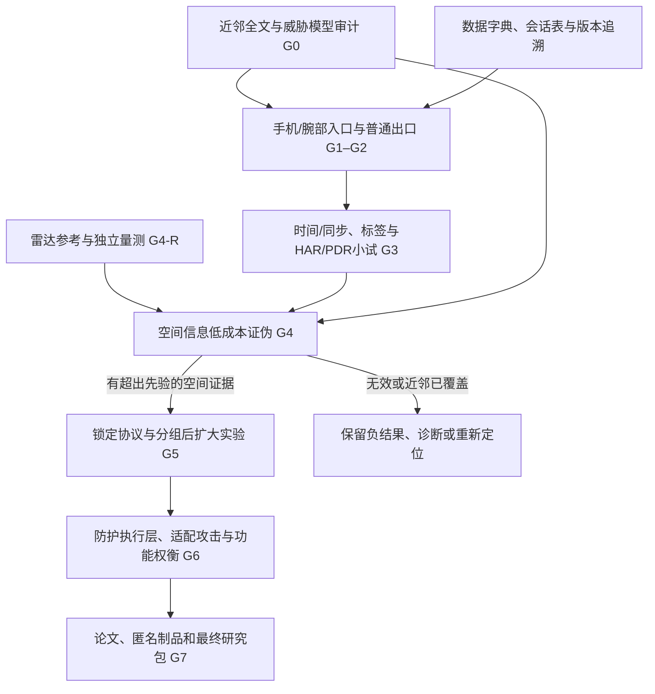

# CCF-A研究合同与流程 v1

日期：2026-10-14，北京时间。状态：Codex整合的当前工作方案；DS015已回传，Codex核验后继续原r2手机短试，未全盘采纳其新增门槛。研究要求由用户与导师确认，不是论文结果或录用保证。历史路线v2保留，当前能力以根PROJECT_STATE.md和原始证据为准。

## 研究问题与目标

研究普通应用实际可访问的手机/腕部惯性信息，能够泄露哪些室内空间关系；泄露随观察时间、路程、覆盖和交互如何变化；腕部增加什么；如何在明确执行层减少泄露并保留活动识别功能。当前没有HAR、轨迹、空间推断或防护结果。

主目标为CCF-A安全/隐私方向的**正式长文**，优先按CCS、USENIX Security组织问题、对照和证据。设备采集、XGBoost、网站和扩大人数均不构成录用保证。若要改变为感知系统论文或其他投稿路线，由用户和导师明确决定，不自动切换。完整3D房间不是首轮交付要求。

一句待验证的论证：在明确运行条件和真实数据出口下，运动信号可能揭示超出布局先验的空间关系；通过预算、改布局、路线、跨人/房间和防护对照，测量其能力与边界。是否存在足够的新颖性和效应尚待证实。

## 对DS流程说明的核对

| DS表述 | 统一口径 |
|---|---|
| 普通应用“没有任何特殊权限” | 改为无root、系统签名、固件改造等特权；普通权限、通知授权、FGS类型、安装方式和省电条件逐项声明。现App声明四权限和specialUse前台服务，不是完全无权限/无需用户操作 |
| 0.2.2入口已通过 | DS说明时仅120Hz约11秒功能短试，基线不足。当前新增100Hz请求的有线534秒/拔线485秒数据分项证据；工具待外审、标准30分钟未验，不能继承为所有配置保证 |
| 用户手动导出后“攻击者能拿到” | 区分应用进程能读取/保存、普通腕部通信、远端获得数据。当前无网络权限的记录器和SAF手动导出不证明自动远端攻击链；ADB/二维码诊断也不能代替普通出口 |
| 不用地图、轨迹和动作真值 | 测试推断时禁止输入这些特权信息；独立评估、标注和无测试泄漏的训练允许使用。理想真值输入只能作单独标记的oracle诊断 |
| 未接触区域应“不知道” | 未触碰不等于无信息：绕行/避障等也可能约束空间。未知对照需控制直接和间接线索；不因某件家具没被触碰就要求整个区域无信息 |
| 至少三条预算曲线 | 还需先验、错配、简单串接/强相关工作基线、负例和校准；曲线本身不证明新颖性或因果。腕部单独能力不足时如实报告，不能制造等价输入 |
| 3人3房间→15–25人/12–20房间/4场地 | 都是初步资源预算。小试用于止损，正式规模依据跨房间差异、区间宽度、资源与伦理流程确定，不能把窗口数当独立样本量 |
| 工具只能工程贡献、网站零科学地位 | 本项目工具和网站当前是采集/复核/沟通支撑，不单独主张科学贡献；也不泛化成所有测量方法、工具或数据资源都不可能产生科学贡献 |
| 可复现包是安全会议统一硬要求 | 按具体届次CFP核查：开放科学说明、审稿制品可访问性与录用后的Artifact Evaluation是不同要求；不等于必须公开全部敏感原始数据 |
| 被拒十次八次因为测量 | 没有对应统计证据，删除该比例；只保留测量可信性是重要风险的判断 |

## 流程与依赖

这不是要求串行等待：手机持续性、S5入口、参考质量方案、文献审计可独立准备。参考误差阻断空间精度结论，不阻断手机工程验收或HAR程序检查。各阶段都保留来源、失败和未知。

## 威胁模型与数据用途

| 环节 | 允许与禁止 |
|---|---|
| 应用部署 | 用户安装普通手机应用及实际需要的腕部程序；安装/配对/授权摩擦如实记录。不声称商店批准、无感安装或全天静默 |
| 主推断输入 | 手机含重力加速度/角速度；腕部仅使用真机证实可读的通道，三轴也可研究，不预设S5六轴。保留实际时间和缺失；不将API值称未滤波硬件原值 |
| 已确认能力 | 现记录器可以读取与保存手机双通道；导出由用户操作。腕部普通出口、远端链路和跨设备同步仍未知 |
| 训练 | 可使用独立训练人/房间的标注和合法公开先验；核对预训练数据近重复泄漏。不得把测试房间变体移进训练 |
| 测试推断 | 不输入目标点云、目标地图/照片、动作或轨迹真值、家具ID/位置、房间标签、真实覆盖/交互数。诊断/分组/评估字段不得被整份sidecar传给模型 |
| 独立评估 | 可用目标参考地图、量测、动作标注和路线检查点计算误差/预算；只由评估程序读取。静态点云不自动提供人体轨迹真值 |
| 坐标 | 使用任意相对起点/朝向；评估可按预先规则做一次平面刚性平移/旋转，禁止缩放或逐时刻真值校正隐藏漂移。配准信息不反馈推断器 |
| 数据出口 | 本地恶意应用读取序列的能力与远端窃取分开主张。完整远端路线另需普通通信实际证据；本轮不向冻结记录器添加联网功能 |

部署威胁可以研究“获准运动功能的数据被二次推断布局”，无需伪装成零用户授权。把“不限制”等操作写成测试条件，而不是默认每台手机已有的能力。

当前声明的FGS/WAKE_LOCK为normal类，FGS_SPECIAL_USE还受appop等运行规则约束；POST_NOTIFICATIONS是运行时授权类。声明、授予、真实运行分别留证。攻击者控制自己App的代码和UID，不与其他应用共享UID。普通腕部→配套手机→后端可分段验证，不要求腕部一定能直接出网。

某个运行状态失败时，可以明确重新限定到已验证的暴露窗口并重审贡献；不得暗改旧失败、假装全天持续或扩大权限来救结果。限定前台窗口能否支撑目标论文，仍须经过G0/G4。

## 术语与输出

| 规范术语 | 定义和边界 |
|---|---|
| 入口验证 | 具体版本/设备/运行状态中，程序实际读取并保存所述信号；不自动包含远端链路 |
| 空间候选 | 交互区域、通行关系、可坐区域等有不确定性的输出；不能自动升级为家具精确中心、类别、尺寸或完整墙图 |
| 实测事件率 | 从sensor_timestamp_ns计算；与请求频率、回调到达率和写盘速度分开 |
| 观测预算 | 同时报告墙钟时长、实际可用片段时长及缺口；L/C/K的参考值只用于评估，不作为攻击输入 |
| 先验/观测 | 先验来自训练与公开统计；观测来自该会话实际信号。移位/无信息对照检验其差别，不能用一句直觉判定 |
| 同权限对比 | 比较方法使用可获得的相同输入与初始化；需要额外姿态/地图的结果另列 |

初期空间输出精度依据观测可支持的内容确定。若只估计人发生坐起的位置，应评估对应交互区域/关系，不能直接宣称恢复家具中心。具体匹配规则、容差和主指标在看正式测试结果前定稿。

不预先锁定完整占据栅格：路径只提供所经局部可通行证据，停步/未访问不自动表示障碍。若后来使用栅格，必须定义占据/通行/未知的来源、参考有效区域、分辨率和未知覆盖。米制误差、IoU、精确率等按各自单位评估，不能要求比例增益大于某个米制容差。

预算曲线必须先截断输入，再计算特征、滤波和推断；不能利用完整会话改善较短前缀。T/L/C/K相关，分别分层或设计匹配对照；不由单条时长曲线推断覆盖/交互的因果。允许曲线不单调，未成功会话进入统计。经验阈值不叫信息论最小运动量。

实际流水线实现时需测试：改变截断点后的数据不会改变该前缀输入/输出；主推断入口不接收真值；训练/测试的物理房间变体与参与者集合符合锁定划分。评估刚性配准参数可保存在受控评估产物中追溯，禁止反馈推断。测试集不能用于调参、选择漂亮片段或挑预算点。

## 参考质量与最小空间证伪

参考质量：先整理已有固定雷达bag，再做同房间同布局的独立重复扫描/参考生成；另一房间复核。预先选择分布在场景中的墙/家具几何量，用独立尺量/测距及重复读数检查；拟合/配准用的控制量与验证量分开。记录绝对偏差、重复性、遮挡与标注不确定性，不只报ICP分数。没有实际误差数值前不报告方法空间精度；数值存在后还须确认误差不主导目标空间效应。具体检查量和精度线待小试/DS核对，不编造合格数字。

DS建议的8–12项量测、3倍p95、5/10cm等只保留为候选讨论，不升格成硬门。小样本p95是描述量，不是总体误差上界；参考误差、人体/家具目标偏移和模型误差分开。固定扫描没有自动的轨迹闭环，点数比例不代表表面面积覆盖。

小试对照包括：已交互物件移位；无直接/间接可区分线索的布局变化；同布局不同路线；先验/手机/腕部/联合/错配联合；手机持续随身与离身分层。A/B布局仅供评估对照，不把测试布局标签或候选地图喂给攻击分类器。自然行为与指令路线分表。

移位对照可匹配起点、非交互路段和任务逻辑，允许接近/交互末端随目标移动；不能要求完整动作完全不变。距路径>R只作操作分层，不证明没有间接信息。重复会话差异叫协议/方法重复性，不称传感器噪声底。无信息区域碰巧猜对可计总体预测表现，但不单独当观测恢复；与先验和配对变化比较、检验高置信错误与校准，不事后剔除正确样本。

腕部增益必须体现在空间层；只有HAR提升不算该贡献成立。若增益只在手机离身时出现，应报告为观测可用性补足，另验共同观测时段的算法增益。人/房间交叉划分，同一物理房间的所有布局变体保持同组；不随机拆相邻窗。三人三房间小试不能证明跨人/房间普适性。

防护需在恶意应用拿到原始值**之前**执行，例如平台/API或可信代理；原值已交给恶意App后再过滤不能形成同一威胁模型的保护。离线模拟与系统强制部署分开，适配/重训攻击者后同时评估空间泄露和功能损失。当前不承诺修改手机或手表系统。

## 当前执行顺序与分工

1. Codex完成本合同、主张—证据表、数据/质量字典和会话sidecar模板；这些准备不需要改App或等待设备。
2. DS015已收到；Codex接受权限分级/泄漏检查等补充，纠正行数已检查、非零闸门外回调不改判等事项。DS仅审查、Codex核验整合；后续按实际阻断再交接，不等待重复原则批准。
3. 0.2.2已由用户完成100Hz请求有线/拔线两条多状态短试，数据分项支持继续，见[本轮验收](../../environment/2026-10-14-手机0.2.2有线与拔线持续性验收.md)。两条UTC均partial、有线告警保留、工具待外审；DS016两条短试复算已由Codex重跑确认一致；随后用户完成标准30分钟拔线288c8700，原r2数据分项通过、无fail/unknown/warning；见environment/2026-10-14-手机0.2.2拔线30分钟验收.md，DS017已复算且Codex重跑确认关键结果；锚点行数/端点误读已纠正，约43ms的LOW→HIGH回调变化补记，不验证45分钟到限。每个新会话使用自己的[2,60)秒基线，不改旧短试未知与旧失败。
4. 并行准备参考误差协议、S5入口/普通出口和近邻全文比较；参考/同步/标签合格后才进入空间证伪，不直接招募大规模数据。
5. 用户于2026-10-15确认此前xpboost指XGBoost，名称疑问已关闭，具体基线配置在小试前固定。用户与导师另行确认机构伦理审批或豁免要求、同意与数据共享范围、场地/参与者资源。没有确认前不把规模草案当招募授权。

主张和证据逐项见[矩阵](claim-evidence-matrix.md)；字段与质量含义见[数据字典](../data/phone-v1-data-dictionary.md)。科研方向、代码、验收和整合由Codex主导；DS为独立审查，长任务另行明确交付；论文署名、伦理与最终投稿决定由用户/导师负责。不开子代理，不自动与DS通信。

## 投稿规则核查范围

2026-10-14读取[CCS2027 CFP](https://www.sigsac.org/ccs/CCS2027/cfp.html)与[USENIX Security2027 CFP](https://www.usenix.org/conference/usenixsecurity27/call-for-papers)相应正文：两者要求开放科学说明，制品访问和不能共享的理由需明确；不能把录用后AE与投稿可访问性混为一谈。敏感数据不要求无条件全部公开。审稿需匿名材料，当前带账号的私有GitHub备份不能直接充当匿名审稿入口。最终公开研究包与审稿包分阶段整理，不现在公开。

CCF官网网络安全目录当前检索仍列CCS/USENIX Security的A类条目；分类页正文存在访问限制，不声称已逐项验收整版目录。[CCF入口](https://www.ccf.org.cn/Academic_Evaluation/NIS/)。正式投稿再核届次规则和学校认定；不将Demo/Workshop、期刊/会议形式自动换算为目标长文。
