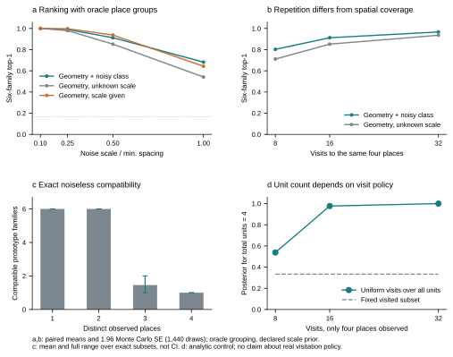
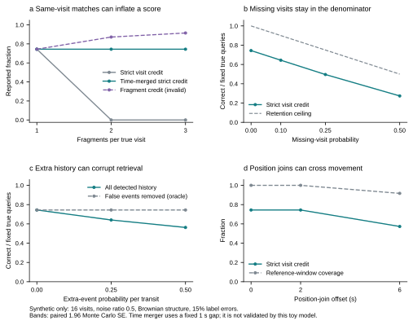
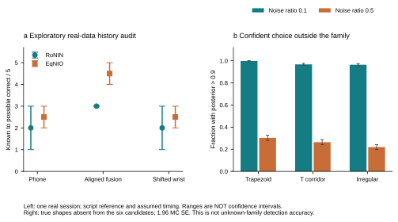

# 手机＋手表：宿舍探索结果与典型空间模拟

2026-10-29。本页替代早期“腕部原文缺失”的当前状态；旧报告保留为历史快照。研究主线仍为联合输入，单端与错配是对照。这里提供汇总与图，私人原始IMU、点云、设备日志、模型权重和签名材料不随本次更新入库。

## 真实宿舍：自动事件到回访身份

手表原文已找回并完成传输核验：2,910条，192.839秒；按现有软件时间关联覆盖八个任务窗，手动停止没有截断这些任务。物理同步仍未验收。

固定1秒时间合并、并只检索查询开始前已结束的历史片段后，概率融合从35个片段变成11个，仍关联8/8脚本声明窗。规则不读取站名、地点数、路线或雷达坐标。这是对同一条已看过的记录作探索性分析，不是独立确认。

| 事件来源 | 合并后片段 | 关联脚本窗 | RoNIN确定至可能正确 | EqNIO确定至可能正确 |
|---|---:|---:|---:|---:|
| 手机单端 | 11 | 5/8 | 1–3/5 | 2–3/5 |
| 手表单端 | 11 | 8/8 | 3–5/5 | 3–5/5 |
| 特征拼接联合 | 11 | 4/8 | 2–3/5 | 2–3/5 |
| 两端概率融合 | 11 | 8/8 | 3/5 | 4–5/5 |
| 概率融合，腕部错开60秒 | 10 | 5/8 | 1–3/5 | 2–3/5 |

所有查询分母固定5；范围来自未标注历史片段，不是置信区间。融合的随机历史基线按实际集合重算，为0.981746–2.473016/5，紧前一次为0/5。手表单端范围仍宽，尚不能声称融合优于手表单端；8/8也不是独立动作标注下的检测精度。

run006的雷达末段空房最大新增0.2753%，超过0.1%门槛；四个动作窗覆盖不足，动作也不满足静止参考假设。因此本次保持探索性等级，不作确认性位置精度证据。采集零点与提示迟到已经更正，分析使用observer.ready_ns，而非公告行墙钟；真实出声时刻仍未测量。

## 模拟：事件错误、空间形状与访问覆盖

新增3,462格×1,440次=4,985,280次试验格；另做全量同随机数复跑。事件错误2,592格、条件原型864格、族外6格。22个主要文件逐字节一致，12个解析/反例测试通过。网格间配对，不是数百万独立人类样本。

候选为宿舍四单元、直走廊、L形走廊、开放办公、双翼和教室排布的四点抽象，不是完整测绘户型。原型排名**预先给定正确地点分组**，属于条件上界；平移消去、连续朝向积分、尺度先验log-uniform[0.5,2]。噪声按合成最小间距归一化，不是米。

固定16次访问、Brownian相关结构、15%粗类错误，六模板平均：

| 噪声比 | 几何、尺度未知 | 几何、只给尺度 | 几何＋有错粗类、尺度未知 |
|---|---:|---:|---:|
| 0.25 | 97.95% | 99.78% | 98.97% |
| 0.5 | 85.21% | 93.80% | 91.27% |
| 1 | 54.16% | 64.34% | 68.22% |

“只给尺度”仍未知朝向和平移，不等同绝对位姿或雷达配准。仅粗类与先验基线均为1/6。后验熵属于模型不确定性，不当作测得的隐私泄漏量。

图a/b：给定正确地点分组；带为均值±1.96倍Monte Carlo标准误，先在每个配对试验内平均六模板。图c：精确子集的均值和完整范围，不是置信区间。图d：不同访问政策的解析对照。8/16/32次始终访问同四处，重复次数不等于空间覆盖。

事件错误也已显式加入。固定上述16访次、噪声比0.5切片：干净严格回访0.7442；25%漏检降至0.4959。若错误地允许同一次访问的碎片互相匹配，三片场景会显示0.9147，严格跨访次计分却为0；固定1秒时间合并在该玩具假设下恢复0.7442。时间合并的真实有效性仍须独立验证。

只观察两个不同地点时，本有限六候选在未知正尺度/旋转/平移下都几何兼容；三处时24个子集中13个唯一，四处时六种各自唯一。这不是任意布局的零信息定理。相同已访问四点嵌入总4/6/8单元时，仅在固定相同访问子集和政策的条件下总数后验保持先验；换成独立均匀访问全部单元的政策，总数后验会变化。

## 真布局不在候选库：高置信度仍可能选错

梯形、T形和不规则点簇未列入六候选。在噪声比0.1、16访次的联合条件下，被迫选择已知类且后验>0.9的比例为99.79%、96.74%、96.39%。这次没有拒识器，不能当未知类检测准确率。

左图是单次真实记录的确定至可能正确范围，非置信区间；右图是独立的合成族外诊断，误差线为1.96倍Monte Carlo标准误。不能将两个分支拼成真实端到端成功率。

## 下一道关

先去掉oracle地点分组，在模拟里由事件、相对位置和有错粗类自行形成分组，再接空间候选排名。保留oracle上界、单端/联合/错配、错误语义硬筛、无回访和对称布局等对照；不靠调整旧ε网格挽救结果。具体方法与文献核对见[下一步与来源](2026-10-29-automatic-place-groups-next-step.md)。

真实独立访次/时刻、合格位置参考及不知地点身份时的布局推断仍未验收。正式空间分数、真实房间排名、真实房间族数量保持null；物理精度、物理时钟和泛化标志保持false。本轮不要求新录制、不训练、不改冻结工具，也未开始论文初稿。

汇总数字见[机器可读切片](results/simulation-checkpoint-20261029.json)。完整逐次结果和全量复跑保留在本机，未随此摘要发布，不能将这个仓库摘要称为完整公开复现包。
