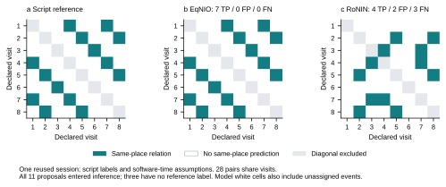
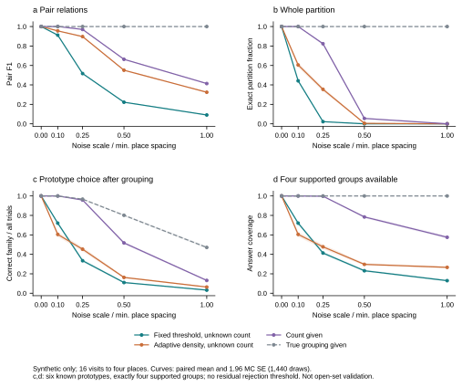

# 自动地点分组跑完了：暂不加起点或地点数限制

2026-10-29。本轮没有采新数据，也没有写论文初稿。手机＋手表仍是主线，旧模型与采集工具保持原样。

## 这次推进到哪了

原来模拟把“哪些访问属于同一地点”直接给算法；这轮把它拿掉，跑通了“自动事件 → 不知地点数的分组 → 有条件地辨认空间原型”。真实旧记录也重放了同一条分支。

现在不必靠“从房门起步”救结果。EqNIO配合固定密度法，在旧记录有脚本参考的八次访问上，找回了全部7对同地关系，没有把21对异地关系并错。RoNIN没有同样成功，而且无回访负对照仍有误并。因此，这是一条有前端条件的探索性正例，离任意路线下的可靠布局恢复还有距离。

## 八站旧记录：不告知三个地点，确实有一条分组能成立

推断先接收两端概率融合提出的全部事件，按固定1秒间隙合并，35片变成11个提议。推断程序不读站名、路线、三处数量、脚本窗口、脚位或雷达坐标。八个脚本窗口只在预测封存后用于计分，另外三个未标注提议一直留在推断里。该臂沿用个人监督标定的活动模型；不是无需示教、跨人或跨天结果。

| 方法 | 前端 | 全部11提议的组数 | 八次声明访问的同地关系 | 五次历史检索 |
|---|---|---:|---|---:|
| 固定阈值，未知数量 | RoNIN | 10 | 找对0，误并0，漏7 | 0/5 |
| 固定阈值，未知数量 | EqNIO | 10 | 找对0，误并0，漏7 | 0–1/5 |
| 固定密度法，未知数量 | RoNIN | 4，另1提议未分配 | 找对4，误并2，漏3 | 2/5 |
| 固定密度法，未知数量 | EqNIO | 4 | 找对7，误并0，漏0 | 4–5/5 |
| 另告知“三处”的完整连接 | 两前端分别跑 | 3 | 各找对7，误并6，漏0 | RoNIN 3/5；EqNIO 4–5/5 |

EqNIO的八次声明访问被分成三个正确组；全11个提议则是四组。第四组对应的事件没有地点参考，不能说“发现四个真实地点”，也不能把它硬塞进四单元房间排名。

历史检索的4–5/5表示有一次选中了未标注历史，身份无法核实。它不是5/5，也不是置信区间。28对关系共享八次访问，整轮只有一个会话，不能按28个独立样本或7个独立正例计算成功率区间。

本轮是预算结束后的离线分组，可以使用整段记录。检索候选仍须在查询开始前结束，但分组已看过后续提议，因此不称实时、在线或因果回访识别。先前最近历史检索只负责选一个历史项，它的全同组占位标签不代表一个真正的全局地图算法，不能拿来比较整图分组能力。

图中对角线不计分。青色表示同地关系；模型的白格也包含未分配情况。所有11个提议参与推断，图上仅展示有脚本参考的八次访问。

## 方法固定在哪，哪些东西没有被偷塞进去

第一条方法是完整连接聚类，距离用记录自身的正距离中位数归一化。开发集独立生成3/4/5/6处点集，seed=2026102903；每种128次，16访次。先要求所有无噪声开发情景完整分组，再按平均pair-F1选参数。封存结果是alpha=0.2、语义权重=0。

联合语义距离这次没有选出增益。这只说明当前二类标记和距离规则没有提供额外分组收益；腕部仍参与上游自动事件提议，不能据此宣布手机＋手表无效。

原加法语义距离在跑开发分数之前被解析反例否定：位置完全重合，只因粗类错了就会被拆开。原合同、原代码和失败测试均保留；改为有限乘法罚项后才生成开发/测试成绩。

第二条是固定参数的HDBSCAN：min_cluster_size=2、min_samples=2、epsilon=0、alpha=1、brute、eom、allow_single_cluster=True、copy=True、n_jobs=1。使用已安装的sklearn 1.9.0，未安装新包。该实现的min_samples包含点自身，不能直接照搬另一个contrib包的数值。没有告知真实地点数，也没有按旧记录调阈值。

密度分支是在固定阈值把旧记录切得过碎后追加的，合同写在密度结果之前；它仍然是已看过旧记录后的探索性扩展，不能当独立盲测。

## 新地点误认成回访，这一关还没过

16次访问各去一个不同地点、没有任何回访的负对照，密度法仍给出5组、4个未分配提议，并预测10对同地关系；这10对全错。反过来，16次都去同一地点时，120对同地全找到了。

这两个结果必须一起保留。密度聚类能恢复重复点簇，不代表它知道什么叫“第一次到新地方”。每组至少两个事件也不等于有两次真实回访。再加地点数不能解决这个问题：旧真实记录告知三处后仍误并6对。

时间敏感性也完整保留。EqNIO概率融合在腕部偏移0的九个软件时钟情景中，除−3秒造成3次参考漏关联、关系变为4对找对/3对漏掉，其余八种均为7/0/0；RoNIN其余八种仍为4/2/3。这些是敏感性假设，不是实测的物理时钟误差范围，更不是九次独立采集。

## 典型空间模拟：去掉真实分组后，损失终于显出来了

主扫描882格×1,440次=1,270,080次试验格；六种既有四点抽象、三种相关结构、8/16/32访次、五档噪声、三档粗类错误，并含漏检/拆片/转场多报。seed=2026102904。密度法在其中162个重叠格子上跑同一批抽样；不能把它再加成独立新数据或新增空间。

下表固定16访次、Brownian相关、15%粗类错误，六模板等权平均。噪声比为“合成噪声尺度 / 真实最小地点间距”，不是米，也没有用雷达误差去标定。

| 噪声比 | 固定阈值 F1 | 密度法 F1 | 告知地点数 F1 | 密度法整条分组全对 |
|---|---:|---:|---:|---:|
| 0 | 1.0000 | 1.0000 | 1.0000 | 1.0000 |
| 0.1 | 0.9117 | 0.9554 | 1.0000 | 0.6049 |
| 0.25 | 0.5168 | 0.8967 | 0.9703 | 0.3545 |
| 0.5 | 0.2221 | 0.5509 | 0.6630 | 0.0051 |
| 1 | 0.0909 | 0.3246 | 0.4140 | 0.0000 |

F1尚可时，整条分组完全正确的比例可能已很低；不能只报前一列。另作未知地点数控制：固定阈值在无噪声K=6随机形状上仍只有81.53%完整分组；原样密度法在同批K=3/5/6无噪声控制上均完整分组。这是有限控制，不是所有几何都能恢复的定理。

曲线带是先在每条配对试验内平均六模板，再取均值±1.96倍Monte Carlo标准误；它描述模拟抽样误差，不描述跨人泛化。四幅图分别看配对关系、整条分组、全部试验中的正确原型数、以及有多少试验获准回答。

| 噪声比 | 分组条件 | 能回答 / 全部 | 答对 / 全部 |
|---|---|---:|---:|
| 0.1 | 固定阈值 | 0.7208 | 0.7206 |
| 0.1 | 密度法 | 0.6049 | 0.6049 |
| 0.1 | 告知地点数 | 1.0000 | 1.0000 |
| 0.1 | 给定真实分组 | 1.0000 | 1.0000 |
| 0.25 | 固定阈值 | 0.4134 | 0.3345 |
| 0.25 | 密度法 | 0.4773 | 0.4527 |
| 0.25 | 告知地点数 | 0.9976 | 0.9583 |
| 0.25 | 给定真实分组 | 1.0000 | 0.9672 |
| 0.5 | 固定阈值 | 0.2314 | 0.1102 |
| 0.5 | 密度法 | 0.2970 | 0.1626 |
| 0.5 | 告知地点数 | 0.7843 | 0.5172 |
| 0.5 | 给定真实分组 | 1.0000 | 0.8015 |

布局分支只在恰好四组且每组至少两个合并提议时回答。对六个四点原型各枚举24种对应，拟合正尺度、连续旋转和平移后，以归一化最小二乘残差排名。这是profile残差分数，不是后验、物理误差或泄漏量。自动分组和真实分组上界使用同一新排名器；不与旧朝向积分模型的91.27%直接相减。

这里还没有用残差拒答。噪声比0.25时，密度法回答47.73%、全部试验中答对45.27%。加上事先列出的0.05残差门，回答降到8.37%，全部中答对8.33%。不能把后者只写成“回答时99.6%正确”。0.02/0.05/0.1/0.2全部曲线保留，均未校准成可靠的拒识门。

事件错误没有藏起来，同一0.25噪声切片另列如下；严格回访保留全部物理访次分母，漏检不从分母拿走，同访碎片不算真正回访。

| 场景 | 固定阈值 F1 | 密度法 F1 | 密度法严格回访 |
|---|---:|---:|---:|
| 干净事件 | 0.5168 | 0.8967 | 0.9172 |
| 漏检25% | 0.5335 | 0.8965 | 0.6263 |
| 每访拆成3片 | 0.5168 | 0.8967 | 0.9172 |
| 转场多报25% | 0.3992 | 0.6997 | 0.7961 |
| 三者组合 | 0.3924 | 0.6450 | 0.5358 |

## 文献和代码帮到了哪

密度法核对来源是[ACM TKDD的HDBSCAN论文](https://doi.org/10.1145/2733381)及[sklearn 1.9.0实现](https://github.com/scikit-learn/scikit-learn/blob/1.9.0/sklearn/cluster/_hdbscan/hdbscan.py)。本轮核过题录、摘要、已安装接口说明与代码参数，没有把摘要说成阅读全文。

此前核对的group-k consistency（DOI 10.1177/02783649241256970）、Kimera-RPGO、CLIPPER也保留在来源记录。后两者分别依赖因子图/里程计/闭环候选，或默认一对一对应及同尺度距离一致性，不能直接接上当前多对一回访且未知尺度的问题。本轮没有把它们当现成解法。

## 这轮验收与下一步

29项测试通过；主扫描与密度扫描完整重放的主要文件逐字节一致，另两份K控制JSON/NPZ也逐字节一致。17,640个独立标量控制复算，指标最大差1.11022e-16；平方profile残差独立实现最大差6.67869e-16；汇总重算差0。受保护旧输入哈希未变。图的字体、排布和遮挡另行验收。

我的裁定：继续保留未知起点、未知朝向、未知地点数的主线，不把“从房门起步”或“已知三处”升成约束。这次的正例足够支持继续做，负对照也明确指出下一步该补什么：在独立合成开发集冻结“不确定就不关联”的规则，同时报告无回访误并、漏检和覆盖率，再原样作用于测试集。若它只能靠已知地点数或运动范围成立，就把新增信息单列成限制条件，不覆盖无约束失败。

现在不要求用户补录。宿舍案例暂作探索性闭环保留；以后要升级真实确认性主张，仍须补独立事件时刻、合格位置参考及跨设备时间证据。run006末段空房0.2753%超过0.1%、四个动作窗参考不足、动作并非静止姿态这些失败保持原样。找回的2,910条腕部记录、192.839秒与手动停止未截断任务窗的旧结论也不变。

formal_score、真实房间排名仍为null；物理精度、物理时钟、泛化标志仍为false。这里没有完成真实宿舍的家具/绝对坐标还原，也没有完成未知布局的开放集识别。

## 复核材料

[结构化汇总](results/unknown-place-groups-20261029.json)随本页保存。本机保留逐试验数组、两轮重放、源代码、冻结合同及完整验证收据；私人原始IMU和点云不在仓库中。
