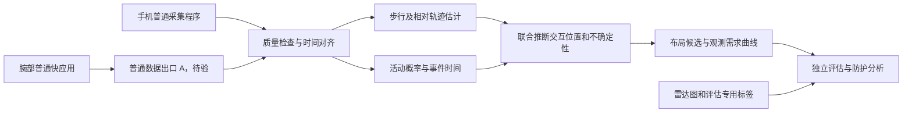

# 手机与腕部运动数据的室内布局隐私：CCF-A 研究总路线 v2

日期：2026-10-13，北京时间。状态：供导师和 DeepSeek 审查的研究草案，不是实验结论或投稿保证。本轮只规划；未授权搭建 Ubuntu、招募参与者、访问新设备或启动训练。后续由主智能体执行，不开启子智能体。

本版在 v1 基础上处理用户转交的 DeepSeek 回传 003。原版与交接 006 保留为历史记录；v2 是当前待审方案。修订依据见 [独立核验](D:/Project/imu环境重建/docs/reviews/2026-10-13-deepseek-003-audit.md)。文献近邻与普通数据出口仍未通过前置审计，没有新设备或模型实测结果。

## 1. 论文要回答什么

研究普通运动应用取得手机和腕部运动信号之后，能够从用户日常运动中推断哪些真实室内布局信息；随观测时长、运动覆盖和家具交互增加，推断能力如何变化；腕部数据增加了多少泄露；能否减少这种泄露并保留活动识别功能。

建议工作题目：**普通手机与智能手表应用的室内布局泄露：现实数据入口、观测需求与隐私—功能权衡**。题目与贡献都需经过近邻排查和实验后修订。

第一阶段主输出为相对坐标中的通行区域、交互位置及粗粒度家具功能候选，例如“可坐物件附近”或“工作表面附近”。墙体边界、家具精确类别/尺寸/朝向和完整 3D 房间只有在证据支持时才加入主结论。无法观测的部分应保留不确定性。

一个具体例子：用户从门边走向书桌，伸手后到另一处坐下；手机尝试估计相对路线，腕部尝试判断这些动作，模型据此推测两个交互区域的关系。坐下本身不能确定椅子还是沙发，未经过或接触的柜子也可能完全没有可区分信号。我们必须通过真实空间误差和改布局对照，判断哪些关系来自观测、哪些来自常见房间先验。已走过的轨迹与外推的通行区域应分别标记，不能将未访问区域写成已观测。

冲 CCF-A 需要可信的新发现或技术贡献和完整证据。设备连接、小模型训练、逼真场景生成都只是环节，不能单独支撑目标。当前不能宣称“首次从 IMU 重建房间”或“已经具有 CCF-A 创新性”。

## 2. 当前事实与条件

| 项目 | 已有证据 | 尚缺条件 |
|---|---|---|
| 手机 | 用户拥有小米 17 Pro，报告可用 Google 服务 | 真机传感器清单、采集 APK、角速度与时间字段、持续运行均未验证 |
| 腕部 | 用户报告已经购买 Watch S5 | 未确认到货、完整 SKU/固件；尚无 S5 安装或采集结果 |
| 既有手环 | 9 Pro 固件 3.1.175、运动健康 3.59.1 为用户报告；普通 RPK 已由用户在实物上运行 | 不能把手环结果转写成 S5 结果 |
| 首个真实样例 | 9 Pro 请求 2 秒，9 页二维码完整恢复，30 条 XYZ，回调跨度 1889 ms，约 15.352 次/秒，中位间隔 64 ms | 仅短样例；单位未知，没有硬件样本时间戳；still 是人为指令，动作真值未验证 |
| 软件 | 普通 Vela RPK、私有文件保存、短二维码导出可用；解码器已能自动恢复用户视频 | 长记录、批量传输、双端同步、S5 界面与型号配置需开发 |
| 雷达 | 已有 Livox MID-360 | 点云建图、语义标注和误差评估未实施；静态点云不自动提供人体轨迹真值 |
| 训练 | 未搭 Ubuntu，未训练分类/轨迹/布局模型 | 电脑 GPU/显存、房间和参与者资源待后续确认 |

真实样例证据：[验收记录](D:/Project/imu环境重建/docs/evidence/2026-10-13-band9pro-video-d6d28b48/真实短样例验收.md)。型号支持来源：[小米 sensor](https://iot.mi.com/vela/quickapp/zh/features/system/sensor.html)、[AstroBox 连接](https://abox.run/docs/usage/connection)。采购商品页未能匿名读取，型号/固件需以到货信息确认。

## 3. 文献定位与路线选择

完整源记录、阅读范围和三份预审见 [文献与审稿自查](D:/Project/imu环境重建/docs/research/2026-10-13-related-work-and-review.md)。

- **Walk2Map（2021）**已经从行走轨迹推断平面布局；轨迹到布局不是新问题。[论文摘要](https://arxiv.org/abs/2103.00262)
- **Pose2Room（ECCV 2022）**已经从人体姿态轨迹推断多种可能的家具配置；活动到家具以及概率输出不是新概念。[作者项目](https://yinyunie.github.io/pose2room-page/)
- **IMU-to-4D（2026 预印本）**已经联合推断运动、活动文本和场景。其 §3.1 使用加速度、角速度和相对旋转；§4 讨论合成训练、真实运动评估和场景评估。必须核对其输入、真实/合成证据与切分，不能直接套到我们的低频腕部三轴数据。[正文](https://arxiv.org/html/2604.21926v1)
- **RoNIN、MobilePoser/IMUPoser**分别是轨迹和消费设备姿态路线的候选基线。源码输入、初始化和权重尚未审计，不默认与本项目同输入。[RoNIN](https://doi.org/10.1109/ICRA40945.2020.9196860)、[MobilePoser](https://doi.org/10.1145/3654777.3676461)
- **PinMe（2018）**已经证明非 GPS 数据可泄露位置，但还使用气压等数据及公开辅助信息；不能宣称运动传感器位置隐私风险是首次发现。[摘要](https://arxiv.org/abs/1802.01468)
- **Indoor localization using device sensors（2024）**已研究恶意手机应用利用运动传感器推断室内轨迹；因此普通应用室内位置隐私也不是新的组合。本轮只有出版社索引摘要，全文和精度定义未审。[出版社](https://www.sciencedirect.com/science/article/pii/S014193312400036X)

Jigsaw、Walkie-Markie 等更早的图像/Wi-Fi 与惯性联合建图、AWare 等传感器访问防护也列入范围比较。G0 继续查近邻和引文，当前列表不代表检索穷尽或已证明缺口。

v2 补充高优先级近邻：PST 2019 **Prying into Private Spaces Using Mobile Device Motion Sensors** 已核题名/DOI，原文未取得，必须先审其路径、地标、普通应用与测试场景，再判断我们的缺口；ShoesHacker 已展示鞋内压力到走廊隐私；RoomE 是 BLE＋腕部惯性信号到房间定位/连通图，不能当纯 IMU 家具重建证据。详细来源和阅读范围见 [回传核验第 4 节](D:/Project/imu环境重建/docs/reviews/2026-10-13-deepseek-003-audit.md)。从“房间级改为家具级”仍不是自动新颖，因为 Pose2Room 和 IMU-to-4D 已涉及家具/场景。

| 路线 | 价值与成本 | 决策 |
|---|---|---|
| A：现实普通应用输入下的布局泄露、双设备增益、观测需求及防护评估 | 与隐私目标一致；必须证明超出先验和现有方法的真实增益 | **主候选，先做低成本证伪** |
| B：重新训练大模型联合生成人体/文本/完整场景 | 计算与数据成本高，直接面对 IMU-to-4D，输入还不匹配 | 不作为首轮主线；仅在来源、权重与硬件允许时对比 |
| C：手机＋手表 XGBoost 活动分类或设备采集报告 | 成本低，可检查信号入口和腕部增益 | 作为基础模块；目前不能独立支撑布局隐私 CCF-A 论文 |

拟争取的贡献是：现实权限下的可复现数据入口和攻击；超出手机与布局先验的空间信息增益；经未见房间和对照验证的经验观测需求；适用边界明确的隐私—功能权衡。每项目前都是待证假设。

## 4. 威胁模型：先锁定，不能为了结果临时扩张

主攻击者为用户安装的普通手机应用及其腕部配套程序的开发者，能够取得两端在正常运行期间实际允许访问的运动信号，并在本地或后端离线分析。用户为运动功能允许采集，不代表允许推断房间布局。

这个模型需要**手机程序和腕部程序都实际存在并有数据出口**。手机程序不能凭蓝牙配对就读取任意手表原始数据。AstroBox 侧载安装是当前原型部署方式，不是应用商店上架或无感后台访问的证明。

主输入：手机实际取得的加速度/角速度，腕部实际取得的三轴加速度，必要的回调/样本时间与缺失标记。公开布局数据可作训练先验；目标房间及近重复布局不能进入训练。SDK 数值不自动称为未滤波的硬件原始样本。

主输入不包含目标房间照片、RGB-D、MID-360 点云、平面图、UWB、Wi-Fi 指纹、GPS、家具真值 ID、动作真值或人体轨迹真值。气压、磁力计与额外上下文若以后加入，须列为新的输入设置，不能混进主结果。

允许离线分析当前已观察到的数据。先不声称实时攻击、静默全天采集或无需用户安装腕部程序。若传感器只在前台可用，论文应报告实际暴露时段与部署摩擦，而不是提高权限救结果。

**出口 A 为攻击能力证据，出口 B 为研究诊断证据。** A1 是普通 interconnect 腕部→同包名/签名的配套 APK，A2 是 S5 文档支持且后续实测成立的普通网络 API；接收端取得完整值后可在本地分析，无需为演示强制上传云端。B 是研究者扫码/拍视频或人工取文件，目前首个样例属于 B；没有 A 的端到端验收，不能宣称已验证完整普通远程攻击。ADB 目前也未用于采集，不将其列为可用攻击能力。

可用暴露预算先限定为实测可采集片段，记录前台可见、前台但息屏、切后台和销毁的实际状态。文档未把 sensor 本身列为后台保活接口，因此不能默认它支持持续后台；同样不能仅凭这点认定息屏一定停止。研究不会为保活追加不相关的音频/位置能力后仍声称原传感器访问条件。

研究用点云、视频、动作标签与轨迹参考用于监督训练/评估：训练房间可作训练目标；**目标测试房间的这些材料只能进入评估器**。人为触发的同步标记要单独说明校准条件；自然使用场景中不能默认攻击者会获得实验者提供的标记。

## 5. 研究问题和可测输出

| 问题 | 要测什么 | 关键对照 |
|---|---|---|
| RQ1 数据入口是否足以支撑空间推断 | 实际通道、时间、可用回调、前后台行为、导出完整性、运行成本 | 文档档位 vs 真机；9 Pro vs S5 分开报告 |
| RQ2 腕部是否增加空间泄露 | 同预算下家具交互位置和通行区推断增益 | 手机单独、腕部单独、联合、时序错配联合 |
| RQ3 观测需求是什么 | 随时长、路程、覆盖和交互数变化的误差与成功率 | 同路线重复 vs 扩展覆盖；交互丰富 vs 只有走动 |
| RQ4 哪些空间信息可区分 | 已交互物体变化的响应、未交互区域的不确定性、预测校准 | 已交互家具移位、未交互家具变化、仅先验 |
| RQ5 怎样减少泄露并保留功能 | 空间推断下降与 HAR/轨迹功能损失的权衡 | 保护后重训攻击者；相同训练预算；长时累积 |

首先测二维相对结构与粗功能候选。完整三维家具盒及墙面只有在独立真值验证后升级为目标。

## 6. 系统和模块分工



### 6.1 两端采集与存储

手机 APK 使用 Android 公开传感器接口，记录实际支持的通道和时间字段；腕部程序沿用普通 Vela 接口。先落盘，再验证 A1 配套通信的包名、签名、型号兼容、getReadyState/diagnosis 和端到端吞吐；该公开页面未提供型号支持明细，不假定 9 Pro/S5 均已适配。

A2 也保留为 S5 候选：本轮官方 fetch/request/uploadtask 支持表均列 S5 为支持、9/9 Pro 为不支持；network 仅是网络信息接口。SDK 支持不证明当前设备具有可用联网路径或已完成上传。若测试 A2，也要检查正常网络条件、平台限制、原值完整性和资源成本，不能只凭 HTTP 页面存在宣称出口成立。A1/A2 都未验证时保持完整攻击未验收；不默认私有 BLE、内核模块或开发特权能救结果。

现有二维码只适合短验收。正式记录器采用有序分块、独立会话 ID、总数与哈希/校验记录，保持原值。当前 2000 条上限不满足分钟级实验，需另开发受容量限制的分块记录器；不能让数组无限增长。

记录元数据：匿名参与者/会话/房间分组，设备角色、完整型号、固件、SDK/API、请求档位、实际回调统计、手机位置、佩戴侧、前后台状态、单位依据和同步条件。实际传感器时间戳不存在时保持空值；不用程序生成的 sequence 假装硬件序号。

升级时保留 `collection/band9pro-probe` 0.1.0 与首个真实记录，新版本单独标记。S5 不硬编码为 9 Pro，型号与固件字段明确标明自动检测或用户报告。

### 6.2 时间对齐与数据质量

手机传感器时间可能是单调时间，腕部当前是 Date.now 到达时间，两者不能直接拼表。先通过两端共同可见标记拟合偏移和漂移，例如 `t_phone = alpha × t_watch + beta`，独立标记验证残差；同时保留平台到达延迟的不确定性。

校准只用于诊断，主攻击还需测试不依赖实验者标记的自动对齐或经普通配套通信取得的时钟关系。两种条件分开报告，否则校准假设可能使威胁模型变强。

重采样不增加观测信息。腕部 15 次/秒不能插值后宣称获得 50 Hz 实测。保留缺失掩码、异常间隔和真实计数。只可测回调/传输完整性，不可在没有硬件样本序号时报告“硬件丢样率为零”。

对单位与坐标轴做静置、翻转和受控运动校准；文档不明的部分保留实验依据与固件范围，不静默填入 m/s²。

**G1-T 时间与回调机制子门：** 静止、走动、转腕分别测试请求档位、实际回调密度、间隔分布、数值变化、长间断和生命周期事件。官方同页既写数据变化回调，也规定约 20/60/200 ms 频率档位，不能据单句宣布变化触发式自适应采样。当前样例平均间隔 65.138 ms、中位 64 ms、p95 76 ms；不是 68.6 ms，更不是固定周期保证。

p95/中位数 <3 仅列为待审诊断建议，不能替代最低可用回调密度、单调性、跳变、漂移与跨设备对齐。file.lastModifiedTime 只用于存储诊断，定义的时区需验证，不能当硬件时钟或独立同步锚；Date.now 与文件写时刻之间也没有天然的独立真值关系。

融合基线包括各端在原生时间中计算特征、经已验证时钟映射匹配同一物理时段后再融合；与有缺失掩码的对齐融合比较。不同回调率、未观察时段和时钟残差分别报告，后融合不能代替时间对齐。

### 6.3 HAR 活动与事件模块

第一版以 XGBoost 为轻量基线，导师的 xpboost 拼写仍待确认。短窗特征包括均值、波动、模长和节奏；输出每类概率，不能只传一个硬标签。先验证走路、静止、坐下/起立，再扩展交互相关动作。

坐下只支持“可坐物件附近”的候选，不直接确定椅子/沙发/床；伸手也不证明触到了家具。活动窗口标签与事件起止标注分开，启停操作的过渡段单独标记。

比较简单阈值、手机 XGBoost、腕部 XGBoost、联合 XGBoost；只有数据规模和误差原因支持时再加入小型时序网络。不以换更大分类器代替空间泄露实验。

### 6.4 轨迹模块

用加速度步态、步长和转向建立 PDR 基线；另审计 RoNIN 等公开惯性里程计的源码输入和初始化条件。需要磁场、目标地图、真值初始方向或超出实际数据的输入时，不列为主同权限对比。

起点和朝向可设为任意相对坐标。评估允许一次平移/旋转配准并明确标注，但不能用缩放、非刚性配准或逐时刻真值校正隐藏漂移。手机手持、固定口袋、拿出再放回分别评估。腕部的时钟/回调缺陷不自动等于手机 PDR 失败；各模块分别验时间，再研究不规则间隔及缺失对联合空间输出的影响。

理想轨迹输入只用于失败定位，标为额外真值诊断；主攻击使用实际预测轨迹。雷达房间地图不能修正主攻击的轨迹。

### 6.5 候选核心方法：把误差和关联歧义一起处理

候选模型维护相对轨迹、交互事件、家具功能候选和关联概率。活动事件在某个不确定的位置形成软约束；重复交互可能帮助检查轨迹漂移和对象重复，但不提供真实家具 ID。相同活动可能发生在多个物件上，必须比较多种关联而不是硬绑定同一椅子。

可先实现概率交互图或带软约束的优化器：运动项来自轨迹模型；活动项来自 HAR 概率；物体类型/位置项受公开先验约束；加入非接触运动作为负例。姿态到物体的偏移也应体现不确定性。

这是待证的技术假设，不是已实现的新算法。Pose2Room 等已有概率方法，因此“使用概率图/因子图”本身不能当创新。主对照必须包含简单的 PDR＋HAR 硬挂点方法，证明联合处理误差有实际价值。

完整人体骨架不是首轮必需输入；如果需要多 IMU 或真值姿态才能得到布局，先报告失败，不能在主输入中偷偷增加设备或骨架。

### 6.6 观测需求与不确定性

观测预算记为 `b = (T, L, C, K)`：可用时长、累计路程、空间覆盖、交互数。真值路程、覆盖和真实事件计数由评估人员计算，不能给攻击模型；模型可以估计自己的对应量。

同时报告墙钟时长、传感器实际暴露片段和中断结构。应用未运行或没有回调的区间不能默认用户静止；T 的有效片段定义需依采集状态和验证协议固定。轨迹跨缺口不可辨时分段或保留不确定性，不能无限拼成一条完整轨迹。先研究真实前台窗口，再单列其他经验证状态。

预算曲线按预先固定的数据前缀和采集协议产生，先截断输入再做滤波/预测，避免用后续信号改善较短预算的结果。不要按测试房间家具真值挑最有信息的片段。

报告不同精度要求下的成功率和置信区间，并区分单房间经验阈值、跨房间统计趋势与未达到阈值的情况。若曲线不单调或有些房间始终无法推断，应如实保留。未经证明，不称“信息论最小运动量”。

## 7. 数据与真值：先小试，再决定正式规模

### 7.1 小试

初步安排 3 名参与者、3 个房间，每个参与者在不同房间做独立会话；用少量静止/走动/坐起/伸手样例验证采集与分类，再做普通日常任务。人数和房间数是小试预算，不是统计充分性结论。

每个会话 5–10 分钟是目标记录长度，须先通过容量和运行测试。不要用当前 2 秒短测试包直接承担小试。记录器就绪前只进行已支持的短验收。

用 MID-360 点云和人工检查建立墙体、通行区域与家具参考。玻璃、遮挡和物体类别须检查。人体轨迹先用已测量路线的起终点/中间检查点诊断；正式密集轨迹真值需单独选定并验证评估用摄像或其他独立跟踪方案。

G4 前先验参考质量：在同一物理房间、同布局下重复扫描及独立测量家具/墙体检查点，再在另一房间复核；“两间房互相配准”没有共同几何时不是有效重复性测试。区分局部 ICP 残差、跨次参考位置差与独立量测误差，明确遮挡/玻璃和人工语义的误差。参考不确定性必须小于拟检测变化，否则先提高真值质量或放宽目标，不能把真值误差当方法精度。

### 7.2 最先做的空间证伪实验

以下是 G1–G3 通过后的小试提案，不能用现有 2 秒记录直接执行：

1. **已交互物件是否可定位：** 在 3 个物理房间中选可安全移位的坐具和固定参考物件，采集用户实际走动及坐起；将坐具移到另一个位置后重新采集。移位量建议先取 1–2 米，依据空间和安全条件调整；这只是受控诊断条件。真实运动、手机单独、联合和简单挂点方法均在相同片段评估，真值只供评估。检查候选位置是否响应，以及误差是否显著小于移位量。
2. **未观测物件是否被猜中：** 在用户未交互的区域改变家具，在类似任务下另采一段。检查高置信错误预测及未知区域变化，不能要求模型准确恢复没有可区分输入的对象。对这些对象预测正确一次也不足以说明来源是观测。
3. **腕部空间增益是否存在：** 固定会话预算，用同一次两端记录比较手机、联合和时序错配联合；记录 HAR、轨迹、交互位置三个层面的误差。如果仅 HAR 改善，空间候选仍与手机或纯先验相同，就未通过双设备布局贡献的门槛。

空间成功精度可先报告 0.5/1/2 米位置容差下的曲线；这些是待审的评估要求，不是预计达到的性能。扩大规模前，要在验证数据上明确主指标和最小有意义的空间增益，并固定接受误差、误检率与置信区间的规则，不能看到正式测试结果才定义成功。3 房间小试用于止损，不用于宣称普适统计结论。

4. **固定布局、变化路线：** 同一房间同布局下采集不同路线/任务，并匹配或分层报告覆盖、交互和暴露量；对共同观测物件比较一致性，对新增观测区域允许输出改变。不能要求不同覆盖的完整预测完全相同。
5. **手机可用性条件：** 分别测试手机持续随身、留在固定位置和间歇随身；这些是明确的日常使用扩展条件，不能混成“用户始终携带手机”的主结论。各条件内比较手机/腕部/联合。离身时段由评估标签分层，攻击器只能从实际可读信号估计状态。若增益只来自手机无运动观测而腕部仍随身，报告为可用性补足，不直接称双设备协同算法贡献。

### 7.3 正式数据的初步资源目标

暂按 15–25 名参与者、12–20 个物理房间、至少 4 个独立场地预算，包含不同大小、家具类别和手机位置。一个房间的多次录制/改布局仍属于同一统计分组，不能算多个独立房间。

正式样本量由小试中的跨房间方差、可获得资源和置信区间宽度决定，不现在宣布已经足够。尽量让同一人访问多个房间、同一房间有多人，降低人—房间绑定混杂。

自然日常任务为主；走边界、指定家具接触、特定同步动作列为受控辅助条件，不据此声称完全被动日常攻击成功。

### 7.4 切分

训练、验证、测试按物理房间/场地分组，房间的所有布局变体进入同一组；参与者另留独立测试组。至少分开报告已见人/未见房间、未见人/已见房间和两者都未见的情况。不能随机拆相邻时间窗。

参数、阈值、缩放器、特征选择和类别决定只用训练/验证集。所有预训练先验检查目标房间近重复泄漏。正式 test 划分锁定后，不根据结果反复换划分。

若只有一个手机型号或一个手表型号，结论限定该配置。9 Pro 可作为不同腕部设备的迁移测试，但不代表所有小米设备。更多设备和固件属于明确的扩展资源，不假定已获得。

批量采集前按所在机构要求完成伦理审查和知情同意；房间布局、时间和家庭位置按敏感数据处理。共享原始室内地图可能需要限制访问。不要把真实家居资料自动上传到模型服务。

## 8. 必须做的实验矩阵

| 实验 | 要排除的解释 | 主要指标 |
|---|---|---|
| 仅布局先验、无目标 IMU | 模型只在猜常见房间 | 物体位置/功能精度、区域误差、置信度 |
| 手机单独／腕部单独／联合 | 联合仅多了一份数据或腕部无增益 | 同预算空间增益，分房间置信区间 |
| 腕部时间错配、缺失/噪声对照 | 模型没有真正利用同步腕部证据 | 相对真实联合的变化 |
| PDR＋HAR 简单挂点 vs 候选联合方法 | 改进只是模块串接 | 位置误差、重复物件关联、校准 |
| 理想轨迹/理想活动诊断 | 分辨失败来自运动、分类还是空间推断 | 额外真值条件与主结果分表 |
| 已交互家具移位 | 是否识别真实空间变化 | 移位响应、匹配误差、误检 |
| 未交互家具移位/增删 | 是否对不可观测区域过度自信 | 预测变化、错误高置信率、不确定性 |
| 路线重复与覆盖扩展 | 时长与新空间观测混淆 | T/L/C/K 分组和匹配比较 |
| 同一布局、不同路线/任务 | 把路线变化当布局变化 | 共同观测对象一致性，覆盖/交互分层 |
| 手机持续随身、离身、间歇随身 | 腕部增益只是手机缺观测 | 条件内手机/腕部/联合，缺口和暴露量 |
| 参考图重复扫描与独立测量 | 方法误差受真值精度主导 | 参考一致性、独立检查点误差 |
| 未见房间、未见参与者 | 记忆目标场景或个人习惯 | 分组测试与置信区间 |
| 手机位置、佩戴侧、实际降采样、同步偏移、息屏 | 对现实条件的敏感性 | 性能、覆盖时段、资源消耗 |

IMU-to-4D 与姿态串接基线先审代码/数据/权重和相同输入可行性。若公开实现无法适配缺失腕部角速度，报告原因并用明确标记的额外六轴诊断；不能伪装成同权限复现。检索与“未复现”不是基线胜利。

## 9. 指标与统计

活动模块：macro-F1、每类召回、混淆矩阵；坐下/起立等事件的 F1 与起止时间误差。事件时间误差作为辅助指标，另报标注精度、最近回调/窗口基线与对齐条件；平均回调率不构成固定事件误差下界，也不能将误差完全归因于方法或采样机制。轨迹：端点和中间检查点误差、相对/绝对轨迹误差，尺度不由真值修正。

空间主指标：预测交互/家具候选与真实对象的匹配精度、召回和中心距离；通行区域重叠及误差。若恢复了真实尺寸，再报告 2D/3D IoU，避免提前用精确盒指标包装不具备尺寸信息的输出。错误类别匹配规则预先固定。

预算指标：不同观测量下的误差、成功率和达到指定精度的比例。应报告多种精度要求的曲线，不只挑一个成功点。观测不足的场景也计入统计。

以独立物理房间为主要重采样/统计单元，参与者作为重复测量因素，避免把数千相邻窗当独立样本。报告按房间聚类的 bootstrap 置信区间与逐房间结果；正式规模不足时说明不确定性，不编造统计功效或普适概率保证。

## 10. 防护模块：必须说明谁能执行

候选为降低回调频率、数值量化、受控噪声、仅暴露必要活动特征或限制累计暴露。这些变换是否有效须检验，长时累积可能恢复信息。

主攻击者若控制已经拿到原值的恶意应用，在该应用拿到原值后再过滤不能保护用户。可执行的主防护假设应是平台/API 层或可信采集代理在第三方读取之前限制输出；需说明实际执行位置。

当前可以做传感器访问策略的离线模拟和研究程序内原型，但不能声称已经在 S5 系统上强制部署。只在后端收到过滤数据的可信客户端模型属于另一种威胁设置，要另列。

防护后重新训练/适配攻击者，与保护前使用相同数据与预算。同步报告空间泄露、HAR 功能和轨迹功能的损失，绘制权衡曲线。加密传输不能解决恶意应用自身读取后的推断风险。

## 11. 阶段安排与停止条件

所有数值门槛是小试前建议的工程判据，需要导师/DS 审查后在验证集锁定；不是已达到的结果，也不是通用 CCF-A 录用线。

| 阶段 | 交付物 | 建议验收与继续条件 | 未通过时 |
|---|---|---|---|
| G0 文献/威胁审计 | 输入与数据切分矩阵、近邻对照、目标输入协议 | 优先审 PST 2019/TTU 原文，再明确与 IMU-to-4D 等的可检验差异；无特权/地图混入 | 核心贡献被覆盖或仅设备换壳/链路重做时先重定位 |
| G1 S5 与手机入口 | 真实短记录、型号固件、实际通道/单位；前台/息屏/后台/销毁分表 | 普通安装并完整保存；诊断出口 B 明示，不能当自动攻击出口 | 不改固件救输入；限制未验状态 |
| G1-T 时间与采集机制 | 原值时间字段、静动回调分布、时钟/缺失报告 | 时间来源清楚、实际密度支持任务、钟跳/漂移可量化；不以 p95 比值单独放行 | 时钟不足则限定窗口/任务，不假造硬件时间 |
| G2 普通出口与联采 | A1 或 A2 的真实小块/分块完整性；5–10 分钟联采、生命周期与时钟报告 | 普通出口 A 实际成立；独立诊断同步 p95 暂以 ≤200 ms 为目标；自动/配套对齐另验 | 仅 B 成功则完整攻击未通过；不扩采 |
| G3 HAR/轨迹小试 | 分组验证结果、动作与路线参考 | 粗活动 macro-F1 暂以 ≥0.80 为目标；事件与轨迹误差须支持后续定位精度，不能只看总体分类 | 限定活动或手机位置；诊断算法与观测缺口 |
| G4-R 参考入场券 | 同房间重复地图及独立量测，第二房间复核 | 真值误差小于拟检测的空间变化；ICP 残差不能单独代替独立精度 | 先修真值或限定输出精度 |
| G4 空间信息证伪 | 3 房间先验/手机/联合/移位/路线/可用性对照 | 多房间空间增益；已交互物件移位响应；未知区保持不确定；可用性补足与共同观测增益分开 | 不先训练大模型；近邻覆盖、先验猜测或腕部只增 HAR 时重定位 |
| G5 正式实验 | 锁定分组、较大规模数据、鲁棒性、置信区间 | 小试效应支持扩大规模，真实条件和未知房间结果成立 | 修订结论范围；负结果不伪装正结果 |
| G6 防护与复现 | 重训攻击者、功能权衡、配置/代码/来源清单 | 清楚说明执行层和效果边界 | 不宣称已部署的系统保护 |
| G7 论文 | 证据图表、相关工作、伦理/开放科学材料、复现包 | 贡献、威胁、实验与结论一致，导师确认 venue | 不因时间快到就降低证据标准 |

首四周的目标是做可行性与证伪：第 1 周文献和设备条件；第 2 周联采/标注；第 3 周活动和轨迹基线；第 4 周小规模空间对照。到货、批量出口或伦理条件未齐会延后，不把四周当论文完成承诺。

到货前可在后续明确实施任务中继续完善记录器与文献审计，沿用 9 Pro 做已授权的短入口检查；到货后仍对 S5 重新验收。本轮仅交付方案和审查材料，未开始这些实施任务。

通过上述门槛后，再按人力与房间资源安排正式采集、方法、鲁棒性、防护和写作。可以按额外 8–16 周估算初稿工作量，但硬件、参与者、算力和新颖性审查未确认，不能保证日历或录用。

## 12. 文件和环境组织建议

```text
collection/android-phone/        手机记录器（拟建）
collection/watch-collector/      S5 分块记录器（拟建，保留旧 9 Pro 原型）
data/raw/                       不覆盖的原始传感器会话
data/annotations/               人工动作标签，训练/评估按权限使用
data/ground_truth/              地图和轨迹参考，禁止主攻击读取测试真值
data/manifests/                 版本、分组、split 与数据来源
research/pipelines/             质量、同步、HAR、轨迹、空间模块（拟建）
research/experiments/            预先固定的预算/对照配置（拟建）
results/                        每次运行的配置、指标、随机种子和日志（拟建）
```

现有文件和用户原始视频保持不变。Windows 上继续完成可行的采集开发；Ubuntu 的 ROS/雷达驱动与 ML 环境分开，版本依据官方兼容性和电脑配置确认。先用轻量 CPU 基线，需要时再加入 PyTorch/GPU；不预先承诺训练 IMU-to-4D 大模型。

## 13. CCF-A 投稿定位

以隐私泄露为主，首先对照 USENIX Security、CCS 的问题与证据标准。CCF 官方目录条目将这两者置于 A 类；本轮搜索可见官方分类，直接读取目录全文受站点校验限制，投稿前仍需核对学校与最新目录。[USENIX 条目](https://www.ccf.org.cn/Academic_Evaluation/NIS/zgjsjxhtjgjxshy/al/2017-03-13/586200.shtml)、[CCS 条目](https://www.ccf.org.cn/Academic_Evaluation/NIS/zgjsjxhtjgjxshy/al/2017-03-13/586204.shtml)

若主要贡献最后变成感知系统和用户研究，再讨论 UbiComp/IMWUT 路线；会议与期刊投稿形式、学校认定不能自动互换。本轮不锁截止日期。当前 [USENIX Security 2027 CFP](https://www.usenix.org/conference/usenixsecurity27/call-for-papers)列有 Open Science 附录要求并推荐讨论伦理；实际投稿按届时目标会议规则准备。

可能的主论证：普通运动应用在现实接口下获取的数据，能在未见房间中泄露可量化的空间信息；联合腕部观测改变泄露曲线；对观测不足区域保持可验证不确定性；访问策略影响隐私与功能。这条论证只有在真实结果支持时成立。

## 14. Codex、用户和 DS 分工

Codex 负责主方案、代码、来源核验、实验组织和整合。用户负责设备现场操作、可授权房间与参与者资源、动作采集与导师沟通。DS 本轮仅独立审查路线；后续只有具备训练机访问和执行工具且用户明确交付时才执行长任务。普通聊天模型不能代替实际训练机，也不能把建议当训练日志。

v1 的完整审查交接见 [交接 006](D:/Project/imu环境重建/DeepSeek交接说明_006_CCFA总路线审查.md)。请求 DS 给出有条件继续/先修改/停止及最低证伪实验，不能只回答“可行、值得做”。
