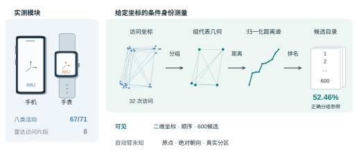
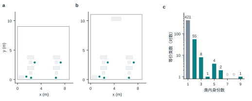
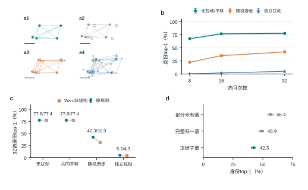
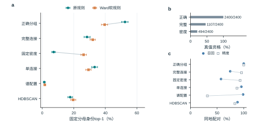
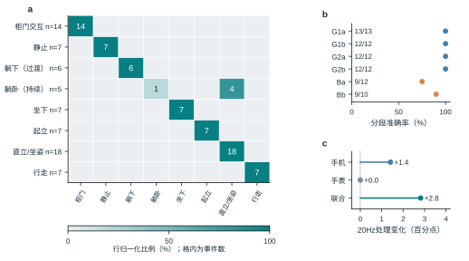
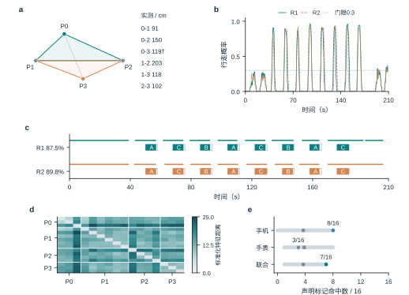
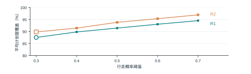

# 可穿戴惯性记录中的空间身份线索

活动表现、访问几何与候选匹配的分层测量

中文研究论文修订稿　2026年11月2日　供导师讨论

## 摘要

活动识别的高准确率能否作为空间身份泄露的证据？本文将这一问题拆为活动判别、访问片段与几何身份三个端点，结合手机手表记录、雷达访问分析及600候选空间的受控闭库测量。在单被试第三批留出记录中，八类联合活动识别达到67/71=94.37%；两布局试点对各八个计划停留窗的平均覆盖为87.50%和89.84%。空间身份需另行评价：16访次的手机静止特征近邻命中为8/16，属于依赖声明标记的小样本诊断。在32次访问、正确分组、末访每轴标准差0.5 m的随机游走误差与固定计数惩罚下，合成闭库身份top-1为52.46%（整房95%区间50.31%–54.40%）。无计数惩罚时，无扰动、共同平移、随机游走与独立扰动分别为77.56%、77.56%、42.33%和5.23%；替换分组或评分规则也会改变身份结果。相对几何因此具有条件身份信息，而活动表现本身不能替代空间身份测量。本文给出两类证据之间的接口、强对照及可重放记录，使空间隐私评价落到明确的输入与端点。代码与匿名派生数据公开于[https://github.com/tuoLuoSuan/imu-layout-privacy-research](https://github.com/tuoLuoSuan/imu-layout-privacy-research)。

关键词：空间隐私；惯性传感器；空间可辨性；访问几何；手机手表

# 引言

手机和手表中的惯性测量单元（inertial measurement unit，IMU）记录加速度与角速度，支持活动监测与相对运动估计[@mobilesensing; @harreview]。同一记录也可能被用于用户并未主动提供的推断。已有工作从手机惯性数据推断敏感室内地点，从行走轨迹恢复平面结构，并从可穿戴IMU联合估计人体运动与场景[@missile; @walk2map; @imu4d]。对空间隐私而言，问题不止是“设备记录了什么活动”，还包括“由记录获得的线索能区分哪个具体空间”。

这两个问题对应不同的证据。动作类别、相对轨迹和同地关系分别描述行为、运动和访问关联，候选身份还取决于空间表示与目录。候选空间可能具有相同的点集表示；前端误差可能保留或破坏相对距离；自动分组还会改变匹配器接收的点数和几何。如果把动作准确率、分组精度和候选排名合称“空间恢复率”，就无法判断哪一种信息支撑了结论。

本文围绕三个可分别检验的问题组织测量：给定访问几何，在有限候选内保留多少身份区分；误差结构与读取规则如何改变这一结果；真实设备记录究竟支持了哪些前端输入。合成实验直接提供带指定误差的坐标，与原始IMU模块分开评价。真实动作、雷达与两布局试点分别评价相应模块。图1给出这些证据之间的关系，表1列明分析者的输入。

本文的贡献如下。

1. 将活动判别、访问关联和候选身份定义为不同评价端点，给出其输入、参考与可比较范围，避免用模块高分替代空间身份结果。
2. 在六房型、600身份和2400路线的冻结闭库中，量化0.2 m表示别名、访问预算与误差结构对身份结果的影响，并保留未被主配置超过的几何强对照。
3. 以同坐标、同候选和同分母比较自动分组及两种评分规则，显示身份损失随二者组合而变，并明确该复合替换不能唯一识别某一环节的因果贡献。
4. 提供真实模块诊断、完整设置敏感性与分层整房区间，将原件重放、保存分数重汇总和图表重绘分别记账。

# 相关工作

## 运动传感与位置隐私

移动传感的隐私风险涉及不同属性。ACComplice使用加速度开展车辆位置推断；PinMe结合传感器、非传感信息与公开地理知识，在没有GPS记录时推断位置[@accomplice; @pinme]。MISSILE更接近本文的室内问题，研究有地点监督条件下的敏感室内位置窃听[@missile]。TapPrints和AccelPrint分别说明动作输入模式及传感器器件差异也可成为侧信道[@tapprints; @accelprint]。这些研究的攻击者信息与输出属性不同，移动侧信道综述也据此区分攻击面[@sidechannelsurvey]；它们不能被合并为一项通用的“IMU定位能力”。

位置序列的规律性与身份区分同样需要区分。个体移动规律、可预测性及稀疏轨迹的再识别研究，分别考察了移动分布、未来位置和轨迹唯一性[@mobility; @predictability; @unique]。这些地理尺度的结果说明位置记录可能包含身份线索，但不直接给出室内惯性点集的匹配率。本文把候选集合、先验与几何表示写入任务定义，测量的是声明闭库内的条件身份。

## 惯性里程计与几何推断

IONet、RIDI与RoNIN研究从惯性序列估计相对运动，TLIO将学习得到的运动信息与滤波结合[@ionet; @ridi; @ronin; @tlio]。OxIOD对应的惯性导航数据与评估、IMUNet的回归架构以及EqNIO的对称性建模，则分别处理数据、效率和方向变换等问题[@oxiod; @imunet; @eqnio]。室内定位综述涵盖的输入和参考更为广泛[@indoorsurvey]。轨迹误差的指标不能直接替代候选身份：同一共同平移可产生位置偏差，却不改变本文使用的两两距离。

Walk2Map从室内行走轨迹提取平面结构，IMU-to-4D的指定预印本版本研究从可穿戴IMU推断人体与场景[@walk2map; @imu4d]。本文与这些工作共享“运动中有几何线索”这一问题，但不提出更高分的重建网络。本文直接给定坐标，检查几何线索在表示别名、分组与匹配规则下还能区分多少候选，并用真实记录核查接口。这样的条件测量也保留了“坐标从哪里来”的独立问题。

## 活动识别与空间端点

惯性活动识别以活动类别为目标，传感器位置、特征和标签定义均会影响结果[@hartutorial; @bao]。OPPORTUNITY、PAMAP2与智能手机活动数据为活动监测提供不同的传感和类别条件；深度卷积循环模型以及IMUTube的虚拟加速度提取则研究识别与数据构建方法[@opportunity; @pamap; @ucihar; @deepconv; @imutube]。本文使用冻结分类器检查当前佩戴与脚本下的活动判别，不与这些不同任务的数据集按准确率排名。八类合并柜门开关改变了任务粒度，亦不能据其高于九类的分数宣称算法改进。

## 隐私保护与评价条件

位置隐私综述和位置隐私量化工作将对手知识、推断目标与损失放在同一评价中[@locationprivacy; @quantpriv]。差分隐私及地理不可区分性提供明确相邻关系或距离定义下的保护形式，不能由某个固定匹配器的降分推导得到[@sensitivity; @geoi]。Mobile Sensor Data Anonymization研究保留活动效用并抑制用户身份，其保护属性是用户身份，而非本文的空间候选身份[@mobileanon]。本文的噪声对照和20Hz处理只涉及所声明的攻击读法与活动效用，不声称得到相应形式保证。全部身份实验仍为已知闭库；开集识别所要求的未知类拒识是另一项任务[@openset; @opensurvey]。

# 威胁模型与评价条件

本文考虑能够读到运动记录或其派生几何的被动分析者。真实模块使用手机与腕部原件；合成身份实验中的分析者则直接获得二维访问坐标、指定误差过程与600个候选站位点集。二者的信息层不同。合成自动臂不知道真实地点分区或被访地点数；正确分组参照单独获得分区。雷达、录像与卷尺用于参考诊断，不作为惯性分析者的额外输入。

{width=16cm}

图1　运动记录、真实模块与条件空间身份的证据流程

手机与手表为原始记录模块的设备示意，左侧列出T3八类活动67/71和雷达8片段两个端点。右侧用同一冻结实例表示32访坐标、组代表几何、归一化距离谱与600候选目录。二维坐标由模拟直接提供，左侧模块没有连接到右侧的坐标生成链。自动臂不读真实分区；52.46%属于正确分组参照、随机游走末访每轴σ=0.5 m、λ=0.0003和2400路线。

表1　分析者输入与参考信息

| 信息 | 合成身份实验 | 真实模块中的用途 |
|----------------|-----------------------|-----------------------|
| 手机、手表原始流 | 不作评分器输入 | 活动判别与片段诊断输入 |
| 二维访问坐标 | 直接提供并加指定误差 | 本轮无同等级位置真值 |
| 600候选站位点集 | 分析者已知的闭库 | 不是实测房屋目录 |
| 原点、绝对朝向 | 不提供 | 不由动作类别补出 |
| 真实分组、地点数 | 仅正确分组参照获分区 | 声明标记仅作诊断参考 |
| 雷达、录像、卷尺 | 不提供给身份匹配器 | 参考与完整性检查 |
| 输出属性 | 声明闭库候选身份 | 活动、片段、回访关系 |

不读取未来事件决定前缀输入，不以候选ID次序破并列。未作答仍保留在原分母中；正确分组参照不是任意攻击者的上界。

表2　主要评价条件与统计单位

| 条件 | 数据与单位 | 输入与判据 |
|--------------------|----------------------|--------------------------------|
| 闭库主条件 | 600房；2400路线 | 32访、随机游走、λ=0.0003 |
| 预算与误差对照 | 同600房；每格2400路线 | 8/16/32访；λ=0；分组正确 |
| 自动分组及软规则 | 同坐标、候选与2400路线 | 六配置；两规则；逐格单列 |
| T3八类活动 | 6会话；71声明窗 | 冻结模型；无连续检测主张 |
| 两布局试点 | 同一人同房；16计划访次 | 覆盖及声明标记近邻诊断 |
| 雷达回访 | 单会话；8片段、28对关系 | 自动生成后与参考对应 |

模拟区间重抽房屋，四路线成组保留；真实事件共享人、房间和会话。不同任务的百分比不组成一项空间恢复率。

# 结果

## 活动表现与空间身份的分层评价

T3八类联合模型答对67/71个声明窗。两布局试点的静止特征近邻诊断则得到手机8/16、手表3/16、联合7/16，标签配额匹配的留一随机点参照为54/240=22.50%。前者评价活动类别，后者评价声明标记的关联，二者使用不同数据与参考。本文据此分别呈现活动表现与空间端点，将坐标身份的测量集中在输入条件可控的闭库。

主要评价条件与统计单位见表2。随后先在可控坐标中测量几何本身携带的身份信息，再检查误差和规则，最后回到真实模块，逐项说明现有记录实际支持的输入。八类活动的设备比较与错误位置见表4和图5，真实片段及标记诊断见图6。

## 访问几何的表示别名

合成候选包含宿舍、公寓、会议室、办公室、教室和酒店六类，每类100套测试房屋，每房四条路线，共2400条查询。独立实验单位是房屋，四条路线整体保留。站位位于0.2 m格点，600个身份在既定点集表示下对应492个等价类。其中421个身份为单例，另外179个身份处于71个多成员类，最大类含9个身份。在均匀先验、类内观测律相同且没有额外区分信息时，完整表示的理想参考为492/600=82.00%。这一参考不约束允许额外语义或访问习惯的所有攻击者。

在32次访问、正确分组参照、随机游走末访每轴标准差0.5 m和原匹配规则下，首位身份命中率（top-1）为1259.105556/2400=52.46%，按房型分层重抽整房的95%区间为[50.31%,54.40%]。421个单例与179个有别名身份分别为66.15%和20.27%。这些数值评价给定坐标的条件身份区分，适用范围为所声明闭库和误差过程。图2以两个冻结候选说明表示别名，并给出完整类大小分布。

{width=16cm}

图2　候选空间的表示别名与等价类分布

a、b，办公室T0319与教室T0448，使用相同米制范围；灰色轮廓与浅灰矩形为冻结生成几何，青色点为0.2 m格点站位，两者的归一化谱差为零。c，全部492个等价类的类大小分布，纵轴为对数计数；421个单例类、71个多成员类共覆盖600身份，类大小7和8的计数为零。

无计数惩罚、正确分组的既有扫描中，访问8、16和32次的top-1依次为22.52%、35.21%和42.33%，top-5为45.04%、63.72%和68.56%。三个预算是同一32步误差过程的嵌套前缀。扩展前缀同时增加空间覆盖、回访与误差积累，因而这里描述该冻结过程中的预算表现，不单独识别访问次数的因果效应。计数惩罚后的52.46%与无惩罚的42.33%也不是两个访问预算。

## 误差结构与访问预算

图3a以冻结路线展示四种误差对访问几何的作用，图3b、c比较全测试集上的访问积累与身份结果。32次访问、正确分组、无计数惩罚时，原规则在无扰动、共同平移、随机游走和独立扰动下的top-1分别为77.56%、77.56%、42.33%和5.23%。共同平移不改变两两距离，其与无扰动同值是表示不变性的控制，不构成第二次独立证据。

{width=16cm}

图3　访问预算与误差结构下的身份区分

a1–a4依次为无扰动、共同平移、随机游走与独立扰动；同一冻结路线、相同比例尺2 m，绘图区包含全部点。b，600房屋各四路线的8/16/32访前缀，原规则、正确分组、λ=0；色带及误差棒均为按六房型分层重抽整房1000次的95%区间。无扰动与共同平移曲线逐项同值，合并标识为不变性控制。c，32访四格，圆为原规则，方为Ward软规则；每组数字按原/软次序给出，原规则有整房区间，软规则因仅有聚合存档而显示点估计。d，同32访随机游走与λ=0下的三种几何读法及整房区间。区间条件于每房型100套的设计，各格分母均为2400。

这些过程通过两点差分进入距离谱。共同偏移在作差时消失；独立误差与随机游走则具有不同的两点误差差分。四格比较同时包含不同的逐访方差分布，同时改变逐访均方根误差（root mean square，RMS）分布与相关性。它说明“位置误差0.5 m”不足以定义当前匹配器的输入条件。

更强的几何读法也必须纳入比较。同一32访、随机游走和λ=0条件下，完整候选归一化谱分位曲线为48.90%，部分米制距离谱为56.45%，部分归一化距离谱为42.33%。本文实现没有超过这两项强对照。米制与归一化读法同时改变目标函数，约14个百分点的差值不能全部归因于尺度信息，冻结主配置保持不变。

## 分组输入与评分规则

将同一批含噪坐标交给自动地点分组后，原固定完整连接和密度法的身份top-1分别为28.38%和7.24%，见表3。正确分组参照只替换访问分区，坐标和候选保持相同；其特权是给定访问分区。

表3　同坐标、同候选和同2400查询分母下的分组输入对照

| 分组输入 | 原规则top-1 | Ward软规则top-1 | 原规则真值资格 |
|------------------|-------------|------------------|------------------|
| 正确分组参照 | 52.46% | 39.55% | 2400/2400 |
| 固定完整连接 | 28.38% | 32.05% | 1107/2400 |
| 固定密度法 | 7.24% | 26.21% | 494/2400 |

主条件为32访、Brownian末访每轴σ=0.5 m、λ=0.0003；软规则欠容量支路λ=0。真值资格指原规则下真实候选满足K≥Q，不是有限得分候选比例。并列信用为解析期望，故正确数可为非整数。

原规则在观测组数Q超过候选站位数K时排除该候选。完整连接和密度法分别有1293、1906条查询在这一条件下失去真实候选。Ward软规则允许将欠容量观测合并到K个代表，使自动臂得分上升，但正确分组参照也下降12.91个百分点。两自动臂与各自参照的差距从24.08/45.22个百分点收窄到7.51/13.34个百分点。软化同时改变候选资格、合并近似和惩罚，这一差距变化反映复合规则替换。

全部六种分组输入的结果见图4。单连接相对完整连接在原规则下高4.83个百分点，在软规则下低2.74个百分点；λ=0时方向仍反转。各房型并不一致，反转只在公寓和办公室两个房型出现。另一方面，既定谱配置的关系召回为98.86%，关系精度为31.75%，原规则身份top-1仅1.28%。同地关系指标与身份排序在这些配置中呈现不同变化。

{width=16cm}

图4　六种分组输入对匹配规则的依赖

同一600房屋、2400路线、32访及λ=0.0003。a，圆为原规则，方为Ward软规则，六配置全部保留；误差棒为按房型分层重抽整房1000次的95%区间。b，原规则下真实候选满足K≥Q的数量，三行分母均为2400。c，六配置的同地配对召回与精度，分别使用实心圆和空心方，两指标均从0起；每路线评价全部496对关系。规则替换的组成与解释见方法。

## 联合活动识别与采样效用

主展示采用八类活动定义：将柜门打开与关闭合为“柜门交互”，其余类别保持不变。这里使用已冻结的八类原生模型，预测结果单独封存。T3的71个声明窗中，联合模型答对67个，正确率为94.37%，事件级Wilson 95%区间为[86.39%,97.79%]、宏平均F1为90.42%；手机与手表分别为60/71和62/71，见表4。该结果对应单人固定佩戴条件下的提示窗任务。

表4　T3八类动作主结果

| 输入 | 正确数/分母 | 正确率 | Wilson 95%区间 | 宏平均F1 |
|------------|--------------|------------|------------------|-------------|
| 手机＋手表 | 67/71 | 94.37% | 86.39%–97.79% | 90.42% |
| 手机 | 60/71 | 84.51% | 74.35%–91.12% | 82.08% |
| 手表 | 62/71 | 87.32% | 77.63%–93.19% | 79.32% |

全部71个声明窗均入分母，缺失0。八类合并了柜门开合，改变了任务粒度，属于任务粒度变化。标签按提示脚本定义；区间作事件级描述，统计单位与参考来源见方法。

{width=16cm}

图5　八类联合识别、设备对照与采样效用

a，T3八类联合混淆矩阵，行是脚本声明、列是预测，格内为事件数，色标为行归一化比例，零计数格为浅灰；行侧列出支撑数n。躺下为过渡类别，躺卧为持续类别；upright包含地面直立与床上坐姿。b，同一71窗在六个留出会话中的正确数/分母；地面和床上会话分别为蓝与橙色。c，冻结八类模型在20Hz手机处理流上的配对变化，单位为百分点，各臂分母71；联合、手机、手表分别增加2、1、0个正确窗。联合双侧精确McNemar p=0.500，手机p=1.000，腕部输入保持原样。

图5a保留完整八类混淆，图5b给出六段记录的分层结果。联合模型的柜门交互为14/14，静止、躺下（过渡）、坐下、起立与行走均未出现错误；四个错误全部为躺卧（持续）被判成upright，躺卧（持续）的召回为1/5。upright在地面和床上覆盖不同姿势，图中标为“直立/坐姿”，未据此重新标注。总体错误集中在躺卧持续类别。

八类联合相对手机的不一致对为7:0，双侧精确McNemar原始p=0.016，任务内三项设备比较经Holm校正后为0.047；联合相对手表为5:0，原始p=0.063、校正后0.125。本批八类的差异出现在联合相对手机的比较。

20Hz处理后的八类联合、手机和手表分别为69/71、61/71、62/71，原始为67/71、60/71、62/71。联合原始独对0条、处理后独对2条，双侧精确McNemar为0.5；手机为1:2、p=1.000。原先样本工程容忍线是针对九类联合基线64/71规定的≥62/71，九类处理后65/71满足该线；该容忍判据属于九类工程检查；空间端点另行评价。

## 真实访问片段与声明标记诊断

固定雷达run007b在2662帧中得到1266帧零候选、1396帧唯一候选，无多候选帧。固定规则不读人工站点窗，形成8个片段，中位时长约17.5 s；全记录分组的关系计数为同地配对找对7、误并0、漏配0、异地配对正确拒绝21（TP/FP/FN/TN=7/0/0/21）。七次历史查询中，完整连接作答5/7且5/5正确，密度法作答7/7但仅5/7正确；两次新地点均被密度法误联。空间反事实零回访输入上，两者误并分别为0/28和21/28。该结果使用一段雷达记录。

新的R1/L0与R2/L1记录完成手机、手表和固定录像收件。原始手机加速度行数为36766和32142，手表为4233和3722行；手表584、563个数据块的循环冗余校验（cyclic redundancy check，CRC）全部通过。两份重组包保留原始phone.zip，在manifest中记录单独手表日志的补入来源，原包未改动。跨端时间采用软件桥观测中位数与软件映射。

样片的30组开发设置产生相同的3个事件，按预声明并列规则选择阈值0.3、最短停留4 s、合并间隙0。样片未区分这些设置，选中项不是由数据选出的最优点。现有评分先从参考中排除三个校准窗，将静止参考切为6个碎片；其一对一匹配结果实际为命中3、误检0、未匹配碎片3，这6个碎片源于校准区间的排除，与三次完整静止区间的计数层级不同。

正式记录中，所选门在R1、R2分别输出10、9个全段事件。自动区间对两段各8个脚本预期停留窗的平均覆盖为56/64=87.50%和57.5/64=89.84%，最低为6.5/8=81.25%，见图6b、c。相对计划到达提示，事件起点提前的中位数为6.5和6.25 s。这里的分母是脚本计划窗总时长，覆盖按0.5 s网格计算；图6保留了全部额外事件和提前边界。

按P0/P3/P1/P2声明标记重汇总后，静止期特征近邻命中为手机8/16、手表3/16、联合7/16，同点/异点平均特征距离比分别为0.849、0.906和0.868。原A/B/C路线角色跨两段复用了A，而物理标记A由P0换成P3，因此本文采用标记标签。图6e给出保留两回合配额的探索置换参照，三设备Holm调整p依次为0.106、0.738、0.117。具体零模型与诊断范围在方法及局限中说明。

{width=16cm}

图6　从两布局输入到事件输出及声明标记诊断

a，两三角形使用五条卷尺边长重建，旁列全部六条实测边（cm）；†为P0–P3，实测119 cm、重建113.2 cm，残差5.8 cm。P0/P3分别是两段的A，P1/P2共用。b，冻结手机门的前向窗行走概率，R1实线、R2虚线，水平点线为0.3阈值。c，灰框为计划窗、彩色填充为与自动区间的重叠、细线为完整自动区间；A/C/B标在计划窗内，平均覆盖R1为87.5%、R2为89.8%。d，16访次按声明标记排列的联合标准化特征距离，色标范围由完整矩阵确定，对角为浅灰。e，点为观察命中数，灰线为固定近邻图、回合内保持配额的313600种分配所生成的中央95%范围，灰点为零模型均值；此范围是置换参照分布，不是命中率置信区间。该诊断的声明参考、全样本标准化与置换假设见方法。

## 事件门的参数敏感性

事后敏感性保留全部30组设置：行走概率阈值0.3–0.7五档、最短时长2/3/4 s与合并间隙0/0.5 s。R1与R2中，每组设置都满足八个计划窗各至少60%覆盖，图7将每段在保存精度内重合的六种组合压为一条线，完整网格保留在源数据。稳定的是这一二元判据；R1全段事件数仍为9–11，R2为9–10，平均覆盖也随设置变化。这组事后敏感性评价的是同两段记录在所测设置下的覆盖稳定性。

{width=16cm}

图7　两段记录的完整事件门设置敏感性

每个阈值对应最短时长2/3/4 s与合并间隙0/0.5 s的六种组合；同一记录的六个平均覆盖读数在保存精度内完全相同，合并为一条线。空心点为样片并列时按预声明保守角选定的0.3阈值，全部30设置仍保留在源数据。纵轴显示80%–100%；两记录在全部设置下均满足八个计划窗各至少60%覆盖。全段事件数仍随设置变化。

# 讨论

空间身份线索在本库中主要由相对访问几何提供，但其可用程度随误差过程与读法改变。无扰动与共同平移同值，说明原点偏移没有进入距离谱；随机游走和独立扰动的结果相差较大，则说明误差的相关结构参与决定候选区分。候选自身的表示别名又引入另一层限制：完整点集也可能对应多个身份。

这一结果补充了惯性定位与场景推断工作之间的一个评价接口。MISSILE在地点监督条件下研究敏感室内位置，Walk2Map从轨迹提取平面结构，IMU-to-4D则从可穿戴惯性输入研究人体与场景[@missile; @walk2map; @imu4d]。本文把坐标到候选身份的条件写入测量，给出表示参考、几何强对照以及分组和评分规则的配对结果。真实模块则分别提供活动、片段和回访证据。

对防护而言，应先明确要移除的信息。所有坐标共享一个平移时，两两距离保持不变，隐藏原点因此保留了这条读法使用的几何。独立扰动和随机游走改变相对距离的方式不同，保护评价需要同时报告相关结构、几何畸变与应用效用。已有移动传感匿名化以具体保护属性定义效用权衡[@mobileanon]；本文20Hz检查完成的是动作效用一侧，后续空间评价应使用相同的保护变换与固定分母。

# 局限

合成身份测量条件于一个生成器、六房型固定配额、0.2 m格点与已知600候选，区间只描述此设计内的整房变异。访问过程排除了紧前一次同站，削弱了gap=1启发式。真实噪声的尺度和时间相关性尚未在同一端到端链路上标定。82.00%是带先验及表示条件的参考，额外语义或访问习惯可能提供其他区分信息。

两种匹配规则的替换同时改变候选资格、Ward合并近似与欠容量惩罚，因而分组与评分的效应无法唯一分解。表A的历史结果没有绑定修复后的源码SHA，本稿保留这一绑定缺口。三个附加分组族各使用一个开发集选定配置，四格软规则只有聚合存档，这些结果界定的是所测方法组合。

真实记录来自单人、同一场景。动作标签来自提示脚本，upright跨地面站姿和床上坐姿；八类合并柜门开关改变了任务。历史T的开发集扩充受T床上混淆影响，第二次评估单列保留。事件共享会话，因此事件级区间和检验不提供跨人效应。技术重录与断电重录保留于既有台账。

两布局的跨端时间为软件对齐，physical_clock_accepted=false；脚位遮挡使标记归属仍依赖声明。计划窗覆盖只统计最大重叠时长，也不充分惩罚窗外区间。最近邻特征共同标准化于16访次，查询共享近邻，置换分析的回合内可交换性仍是探索假设。它没有完全控制路线、脚本行为与时间的混杂，非显著结果也不证明某设备没有空间信号。原始记录超过原定240 s长度，完整文件保留，分析窗仍沿用冻结任务区间。

真实房间端到端身份、库外拒识和适应性攻击下的保护效果仍不在现有验证范围内；formal_score及real_*保留null。活动准确率、计划窗覆盖和闭库身份表现因此分别报告。

# 结论

本文将可穿戴记录中的活动表现、访问关联与空间身份定义为独立评价端点，并在冻结闭库中测量了相对几何的条件身份信息。给定坐标、正确分组和指定误差时，600候选内的身份top-1达到52.46%；误差结构与读取规则共同改变这一结果。真实模块提供了活动及访问证据，也明确了坐标级输入仍需单独评价。空间防护的效用与保护效果应在同一变换、明确输入和固定分母下联合报告。

# 方法

## 任务、表示与固定分母

合成分析者得到每条记录的二维访问坐标及全部600候选站位点集。原点和绝对朝向不提供，自动臂不读测试真实分区或真实地点数。候选点数属于已知目录信息，真实粗类型仅在明确标记的特权对照中使用。正确分组参照单独获得访问分区，用于隔离这一输入条件。

对点集 $P$ 的两两欧氏距离排序后，按其均方根归一化，定义距离谱：

$$\mathbf{s}(P)=\frac{\operatorname{sort}\{\|\mathbf{p}_i-\mathbf{p}_j\|_2:i<j\}}{\sqrt{M^{-1}\sum_{i<j}\|\mathbf{p}_i-\mathbf{p}_j\|_2^2}},\quad M={|P|\choose 2}.$$

式（1） 中的 $M$ 为点对数，$P$ 中的每个点为二维站位。该谱不使用原点、整体旋转、点编号或统一尺度，但可能把不同几何映为同谱。若归一化分母为零或有效点数不足，则按冻结实现记录不可评分，退化点集按原口径计入分母。

对查询 $r$，令 $T_r$ 为并列首位候选集合，$h_r$ 为真实候选身份。身份信用与总体top-1为：

$$a_r=\begin{cases}|T_r|^{-1},&h_r\in T_r,\\0,&\text{其他情形},\end{cases}\qquad A=\frac{1}{R}\sum_{r=1}^{R}a_r,\quad R=2400.$$

按 式（2） 计算时，不按ID顺序破并列。未作答记0，分母仍为全部查询。作答率和已答精度另行计算，固定分母表现与拒答指标分别列示。对 $N$ 个均匀先验身份，若表示划分为 $m$ 个等价类，且类内观测律相同、没有额外侧信息，则完整表示理想参考为：

$$A_{\mathrm{rep}}=\sum_{C}\frac{|C|}{N}\frac{1}{|C|}=\frac{m}{N}.$$

式（3） 中的 $C$ 遍历等价类。本库 $m=492$、$N=600$；这是一项附带假设的表示参考，其范围限于指定表示及观测条件。非均匀先验下相应表达为各类最大先验概率之和。

## 误差过程与候选匹配

随机游走以32访为固定完整过程。真实位置 $\mathbf{x}_i$ 的含噪观测为：

$$\widetilde{\mathbf{x}}_i=\mathbf{x}_i+\frac{\sigma}{\sqrt{32}}\sum_{j=1}^{i}\mathbf{z}_j,\qquad\mathbf{z}_j\sim\mathcal{N}(\mathbf{0},I_2),\quad\sigma=0.5\,\mathrm{m}.$$

式（4） 中的 $\sigma$ 是第32访每轴误差标准差。8访、16访末次标准差分别为0.25 m、约0.3536 m，各预算分母始终为√32。共同平移为所有点共享同一误差，独立扰动为每访独立采样。RoNIN刚性拟合RMS、雷达回访散布与这里的σ定义不同，分别按其测量定义记录。

给定 $Q$ 个观测组代表与 $K$ 点候选，原规则枚举候选 $Q$ 点子集，取与观测归一化谱的最小RMS差 $d$，并计算：

$$S=\sqrt{d^2+\lambda\log{K\choose Q}},\qquad\lambda\in\{0,0.0003\}.$$

式（5） 在 $Q>K$ 时硬排除候选。Ward软规则在K≥Q时不变；2≤K<Q时将Q个观测代表按Ward准则合并为K个点，与候选完整谱比较，该支路λ=0。它是确定性近似，采用确定性的层次合并近似。源码修复前的表A存档未绑定当前源码SHA，表B和四格则绑定各自快照；历史绑定缺口见局限。

## 分组与统计单位

固定完整连接以正两两距离中位数作尺度，截断值α=0.2。固定密度配置采用层次密度聚类HDBSCAN（hierarchical density-based clustering），min_cluster_size=2、min_samples=2、epsilon=0、allow_single_cluster=True[@hdbscan]。未分配访问各保留为单例，32访全部进入一个且仅一个组，组代表为坐标均值。附加单连接、谱和HDBSCAN配置在72开发房屋的288路线中按输出组数与真实被访地点数误差选择，未用测试身份得分选优。

模拟区间采用bootstrap分位数法，按六房型固定配额分层重抽整房1000次，每房四路线整体保留[@bootstrap; @bootstrapbook]。本轮从冻结逐路线分数重汇总，统一采用种子2026110201和同一抽样索引；不重算匹配分数。区间条件于当前生成器与每类100套的设计，不覆盖跨生成器或跨种子的变异。规则反转与相应对比是在已有封存分数上提出的事后汇总，按事后探索汇总记录。421/179子集与全库重叠，共享相同独立房屋。

动作区间使用事件级Wilson方法，设备差异采用精确McNemar并在各T3任务的三项设备比较内做Holm校正[@wilson; @mcnemar; @holm]。活动事件共享会话；两布局的16访次与56对关系来自同一人和房间，按重复观测记账。

## 动作任务与历史评价

九类历史结果单独保留以交代任务变化。原13会话、165个事件中，最初五会话开发集对应T确认性65/71=91.55%，Wilson区间[82.76%,96.07%]；受T床上混淆影响加入D-Ba与D-G1a复录后，同一T第二次评估为67/71=94.37%，区间[86.39%,97.79%]、宏平均F1为93.80%，与确认性结果并列。它与T3八类的94.37%恰好相同，但任务、批次和宏平均F1不同。模型选择与评价复用可能带来偏差，小样本区间亦不能覆盖跨人的变异；这些是独立于模型分数的评价问题[@varma; @varoq]。T2九类联合/手机/手表为61/63/56，T3为64/58/56，各分母71。T3九类联合相对手机6:0的原始p=0.031、Holm后0.063，未达0.05；T2/T3合并6:2的原始p=0.289，两批方向存在差异。

## 真实动作、雷达与两布局输入

历史动作标签以提示脚本声明为参考，执行未经独立视频核验。动作窗固定为提示起点后1至4 s的三秒窗，基础统计附加三个1 s子窗模长、首尾0.5 s方向、积分及手机陀螺能量。八类模型合并柜门开合后使用已冻结原生模型，九类历史臂另存；联合臂拼接手机与腕部特征，随机森林400棵树、random_state=0，不作标准化[@rf]。扩展开发集为7会话94事件，1个事件缺有效腕部输入，联合与手表训练量93、手机94。重录台账登记T2两笔技术故障、T3五笔断电；D-Ba原先缺手机记录，经补录进入扩展开发集。这些中断与补录不扩大独立样本量，评价沿用各批次封存分母。当前分析只加载冻结模型，不重新拟合。既有手机轨迹接口复用预训练RoNIN及已核验权重，该轨迹接口只核验可运行性[@ronin]。

雷达候选采用5 cm唯一体素、0.15 m格26邻接、至少20体素和z跨度0.30 m等既定门。自动片段按时间间隔、空间直径、持续时长及唯一候选比例生成，不读取脚本站点窗。参考窗口仅在事后评价使用。雷达不是惯性攻击者输入，也没有与新两段建立三端物理对时。

两局部布局共享P1/P2，A分别为P0/P3，路线均为A C B A C B A C。六条卷尺边长恢复的两三角形归一化谱差为0.1203；交叉边一致性残差为5.8 cm，该残差描述卷尺边之间的一致性。脚位被身体遮挡，标记归属来自声明与画面可见标记，参考层级见局限。

两段原始手机传感跨度为310.82 s和271.74 s，超过此前每段实际≤240 s的计划；视频音轨分别为291.072 s和276.757 s。本稿保留完整原件，分析任务窗仍为提示零点后[40,187) s。手表为单独导出的同次日志，补入新包并保留repair清单；文件完整性与时间映射分别验收。

实际诊断代码以0.5 s步长提取[s,s+3)前向窗，区间输出标到s，须与输入结束和可用时刻区别。该实现是离线诊断，保留前向窗的可用时刻差异。选择规则先最大化命中减误检，再依次选择少误检、低阈值、长最短停留和小合并间隙。样片去掉校准段后参考被切成碎片，其匹配计数与物理停留次数不同。

计划窗覆盖定义为自动事件与每个脚本预期停留窗的最大重叠时长，除以该计划窗长度：

$$c_j=\frac{\max_i|E_i\cap W_j|}{|W_j|}.$$

式（6） 中的 $E_i$ 为自动区间，$W_j$ 为8 s脚本计划窗，$j$ 为访次。该定义只计算窗内重叠，因此正文同时给出完整事件图与提前边界。站点最近邻诊断在16个提示后[4,7) s窗上，以模型列序提取特征，逐特征共同标准化后用欧氏距离留一取近邻；该步骤为转导诊断。按声明物理标记计数为3/3/6/4，随机留一标签匹配概率为54/240=22.5%。

20Hz效用处理先将手机加速度、角速度在原支持内插值到200Hz处理网格，经4阶8Hz单向Butterworth低通后每10点保留1点，手表原流不变。处理沿用原始信号的有效带宽。旧T3在看过结果后开展配对探索，样本容忍只针对当前批次。本轮未完成七臂空间排名与相应20Hz空间分数，该端点与活动效用分别记账。

## 声明标记近邻的探索置换

16个留一查询共享特征和近邻，故本轮采用固定有向近邻图、回合内保持声明标记配额的探索零模型。先核对三设备全部近邻索引与保存结果，随后枚举两回合各560种3/3/2配额分配，共313600种组合；统计量为近邻两端标记相同的有向边数。上尾p包含与观测相等的分配，三设备构成一个Holm家族。手机、手表、联合的原始p分别为0.035、0.738、0.058，调整后为0.106、0.738、0.117；完整尾部计数与零分布随源数据提供。此分析在已见8/16、3/16、7/16后制定，协议和代码分别封存，按事后探索报告。

若把16窗视为独立二项试验，并使用总体配额参照0.225，确可复算原始p=0.015、0.733、0.048；其独立性假设与共享近邻的结构不符，因此该读数仅留在统计审查文件中。图6e的灰线是条件零模型的中央95%范围，不是观察命中率的置信区间。

## 可重放性与来源范围

试点27件产物有逐文件SHA256清单，重组包保留原手机包并登记补入手表日志的来源。既有雷达自动接口的run与replay逐字节相同。此处“可重放”按层记账：恢复原件后的冻结特征和模型重放、模拟保存分数的重汇总，以及汇总值的绘图，是三个不同范围。表A的历史源码绑定缺口仍保留，当前源码散列不能补证过去版本。

本轮27个评分条件的区间、等价类直方图与30组门设置由列明输入导出。两遍独立运行生成的五个JSON逐字节一致，七项输入的SHA256前后相同；这仅证明本轮重汇总可重放，不声称重新运行了全部原始匹配器。图表随附分子、分母、值及区间来源；模拟并列信用允许分子为非整数。网站读取这些冻结产物，本身不重算分数。

# 数据与代码可用性

源码、匿名逐房分数、图表源数据与重建入口已公开。仓库地址如下。

[https://github.com/tuoLuoSuan/imu-layout-privacy-research](https://github.com/tuoLuoSuan/imu-layout-privacy-research)

本稿对应版本标签paper-figures-v3-20261102，仓库首页指向当前论文目录与复现说明。图件同时提供中文与英文版本，数值相同。原始参与者录像、手机手表导出包、点云原件、模型权重与签名材料不随该仓库分发。

复现范围分层记录：恢复原件后的冻结特征及预测重放属于既有审核，本文27个条件的区间从保存分数重汇总；图表代码直接读取匿名派生数据。近邻置换分析固定既有图与标签配额，不训练模型或改变原匹配分数。

# 作者声明

作者姓名、顺序、单位、贡献、基金、利益冲突以及伦理适用性需由作者和所在机构在投稿前确认。本稿不虚构伦理批准编号或独立位置真值。本文结构整理、代码与语言编辑使用大型语言模型辅助；作者须在提交前复核数据、引用、分析与结论，并按目标期刊要求披露相关使用。当前文件用于导师讨论，不是已完成签字或正式提交的版本。

# 参考文献
