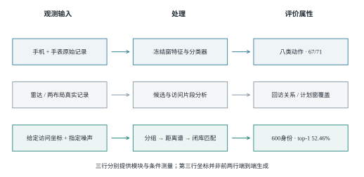
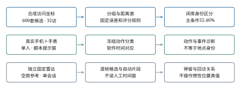
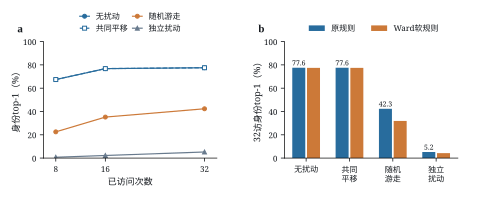
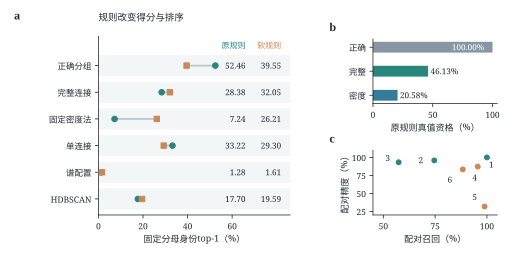
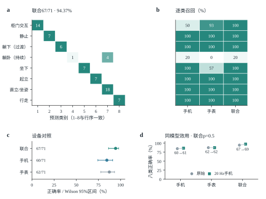
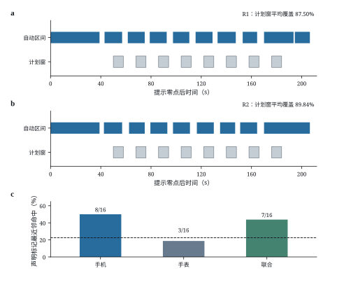
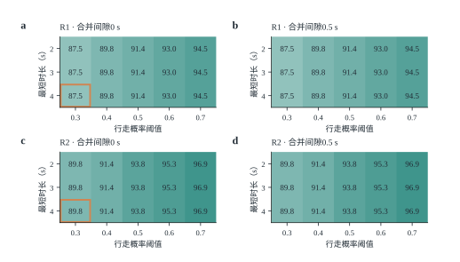

# 可穿戴惯性记录中的空间身份线索

活动表现、访问几何与候选匹配的分层测量

中文研究论文初稿　2026年11月2日　供导师讨论

## 摘要

活动识别的高准确率能否作为空间身份泄露的证据？本文将这一问题拆为活动判别、访问片段与几何身份三个端点，结合手机手表记录、雷达访问分析及600候选空间的受控闭库测量。在单被试第三批留出记录中，八类联合活动识别达到67/71=94.37%；两布局试点对各八个计划停留窗的平均覆盖为87.50%和89.84%。空间身份需另行评价：16访次的手机静止特征近邻命中为8/16，属于依赖声明标记的小样本诊断。在32次访问、正确分组、末访每轴标准差0.5 m的随机游走误差与固定计数惩罚下，合成闭库身份top-1为52.46%（整房95%区间50.31%–54.40%）。无计数惩罚时，无扰动、共同平移、随机游走与独立扰动分别为77.56%、77.56%、42.33%和5.23%；替换分组或评分规则也会改变身份结果。相对几何因此具有条件身份信息，而活动表现本身不能替代空间身份测量。本文给出两类证据之间的接口、强对照及可重放记录，使空间隐私评价落到明确的输入与端点。

关键词：空间隐私；惯性传感器；空间可辨性；访问几何；手机手表

# 引言

手机和手表中的惯性测量单元（inertial measurement unit，IMU）记录加速度与角速度，支持活动监测与相对运动估计[@mobilesensing; @harreview]。同一记录也可能被用于用户并未主动提供的推断。已有工作从手机惯性数据推断敏感室内地点，从行走轨迹恢复平面结构，并从可穿戴IMU联合估计人体运动与场景[@missile; @walk2map; @imu4d]。对空间隐私而言，问题不止是“设备记录了什么活动”，还包括“由记录获得的线索能区分哪个具体空间”。

这两个问题需要不同的证据。坐下的类别标签不等于椅子身份，相对轨迹不提供房间原点，正确的同地关系也未必对应唯一候选布局。候选空间可能具有相同的点集表示；前端误差可能保留或破坏相对距离；自动分组还会改变匹配器接收的点数和几何。如果把动作准确率、分组精度和候选排名合称“空间恢复率”，就无法判断哪一种信息支撑了结论。

本文围绕三个可分别检验的问题组织测量：给定访问几何，在有限候选内保留多少身份区分；误差结构与读取规则如何改变这一结果；真实设备记录究竟支持了哪些前端输入。合成实验直接提供带指定误差的坐标，不将其冒充已由原始IMU恢复的轨迹。真实动作、雷达与两布局试点分别评价相应模块。图0给出这些证据之间的关系，表1列明分析者的输入。

本文的贡献如下。

1. 将活动判别、访问关联和候选身份定义为不同评价端点，给出其输入、参考与可比较范围，避免用模块高分替代空间身份结果。
2. 在六房型、600身份和2400路线的冻结闭库中，量化0.2 m表示别名、访问预算与误差结构对身份结果的影响，并保留未被主配置超过的几何强对照。
3. 以同坐标、同候选和同分母比较自动分组及两种评分规则，显示身份损失随二者组合而变，并明确该复合替换不能唯一识别某一环节的因果贡献。
4. 提供真实模块诊断、完整设置敏感性与分层整房区间，将原件重放、保存分数重汇总和图表重绘分别记账。

# 相关工作

## 运动传感与位置隐私

移动传感的隐私风险涉及不同属性。ACComplice使用加速度开展车辆位置推断；PinMe结合传感器、非传感信息与公开地理知识，在没有GPS记录时推断位置[@accomplice; @pinme]。MISSILE更接近本文的室内问题，研究有地点监督条件下的敏感室内位置窃听[@missile]。TapPrints和AccelPrint分别说明动作输入模式及传感器器件差异也可成为侧信道[@tapprints; @accelprint]。这些研究的攻击者信息与输出属性不同，移动侧信道综述也据此区分攻击面[@sidechannelsurvey]；它们不能被合并为一项通用的“IMU定位能力”。

位置序列的规律性与身份区分同样需要区分。个体移动规律、可预测性及稀疏轨迹的再识别研究，分别考察了移动分布、未来位置和轨迹唯一性[@mobility; @predictability; @unique]。这些地理尺度的结果说明位置记录可能包含身份线索，但不直接给出室内惯性点集的匹配率。本文把候选集合、先验与几何表示写入任务定义，测量的是声明闭库内的条件身份。

## 惯性里程计与几何推断

IONet、RIDI与RoNIN研究从惯性序列估计相对运动，TLIO将学习得到的运动信息与滤波结合[@ionet; @ridi; @ronin; @tlio]。OxIOD对应的惯性导航数据与评估、IMUNet的回归架构以及EqNIO的对称性建模，则分别处理数据、效率和方向变换等问题[@oxiod; @imunet; @eqnio]。室内定位综述涵盖的输入和参考更为广泛[@indoorsurvey]。轨迹误差的指标不能直接替代候选身份：同一共同平移可产生位置偏差，却不改变本文使用的两两距离。

Walk2Map从室内行走轨迹提取平面结构，IMU-to-4D的指定预印本版本研究从可穿戴IMU推断人体与场景[@walk2map; @imu4d]。本文与这些工作共享“运动中有几何线索”这一问题，但不提出更高分的重建网络。本文直接给定坐标，检查几何线索在表示别名、分组与匹配规则下还能区分多少候选，并用真实记录核查接口。这样的条件测量也保留了“坐标从哪里来”的独立问题。

## 活动识别与空间端点

惯性活动识别以活动类别为目标，传感器位置、特征和标签定义均会影响结果[@hartutorial; @bao]。OPPORTUNITY、PAMAP2与智能手机活动数据为活动监测提供不同的传感和类别条件；深度卷积循环模型以及IMUTube的虚拟加速度提取则研究识别与数据构建方法[@opportunity; @pamap; @ucihar; @deepconv; @imutube]。本文使用冻结分类器检查当前佩戴与脚本下的活动判别，不与这些不同任务的数据集按准确率排名。八类合并柜门开关改变了任务粒度，亦不能据其高于九类的分数宣称算法改进。

## 隐私保护与评价条件

位置隐私综述和位置隐私量化工作将对手知识、推断目标与损失放在同一评价中[@locationprivacy; @quantpriv]。差分隐私及地理不可区分性提供明确相邻关系或距离定义下的保护形式，不能由某个固定匹配器的降分推导得到[@sensitivity; @geoi]。Mobile Sensor Data Anonymization研究保留活动效用并抑制用户身份，其保护属性是用户身份，而非本文的空间候选身份[@mobileanon]。本文的噪声对照和20Hz处理只涉及所声明的攻击读法与活动效用，不声称得到相应形式保证。全部身份实验仍为已知闭库；开集识别所要求的未知类拒识是另一项任务[@openset; @opensurvey]。

# 威胁模型与评价条件

本文考虑能够读到运动记录或其派生几何的被动分析者。真实模块使用手机与腕部原件；合成身份实验中的分析者则直接获得二维访问坐标、指定误差过程与600个候选站位点集。二者的信息层不同。合成自动臂不知道真实地点分区或被访地点数；正确分组参照单独获得分区。雷达、录像与卷尺用于参考诊断，不作为惯性分析者的额外输入。

{width=16cm}

图0　运动记录、真实模块与条件空间身份的证据流程

三行分别表示活动判别、真实访问分析与给定坐标的合成身份测量，行间没有已实现端到端生成关系。52.46%属于32访、正确分组、指定随机游走与λ=0.0003；67/71属于T3八类提示窗。雷达为参考模块，600候选不表示600个真实采集房间。

表1　分析者输入与参考信息

| 信息 | 合成身份实验 | 真实模块中的用途 |
|----------------|-----------------------|-----------------------|
| 手机、手表原始流 | 不作评分器输入 | 活动判别与片段诊断输入 |
| 二维访问坐标 | 直接提供并加指定误差 | 本轮无同等级位置真值 |
| 600候选站位点集 | 分析者已知的闭库 | 不是实测房屋目录 |
| 原点、绝对朝向 | 不提供 | 不由动作类别补出 |
| 真实分组、地点数 | 仅正确分组参照获分区 | 声明标记仅作诊断参考 |
| 雷达、录像、卷尺 | 不提供给身份匹配器 | 参考与完整性检查 |
| 输出属性 | 声明闭库候选身份 | 活动、片段、回访关系 |

不读取未来事件决定前缀输入，不以候选ID次序破并列。未作答仍保留在原分母中；正确分组参照不是任意攻击者的上界。

表2　主要评价条件与统计单位

| 条件 | 数据与单位 | 输入与判据 |
|--------------------|----------------------|--------------------------------|
| 闭库主条件 | 600房；2400路线 | 32访、随机游走、λ=0.0003 |
| 预算与误差对照 | 同600房；每格2400路线 | 8/16/32访；λ=0；分组正确 |
| 自动分组及软规则 | 同坐标、候选与2400路线 | 六配置；两规则；逐格单列 |
| T3八类活动 | 6会话；71声明窗 | 冻结模型；无连续检测主张 |
| 两布局试点 | 同一人同房；16计划访次 | 覆盖及声明标记近邻诊断 |
| 雷达回访 | 单会话；8片段、28对关系 | 自动生成后与参考对应 |

模拟区间重抽房屋，四路线成组保留；真实事件共享人、房间和会话。不同任务的百分比不组成一项空间恢复率。

# 结果

## 活动表现与空间身份需要分别评价

T3八类联合模型答对67/71个声明窗，而两布局试点中手机静止特征的声明标记近邻命中为8/16、联合为7/16。后两项均高于标签配额匹配的22.5%随机点参照，但样本仅16访次、特征共同标准化、标记归属依赖脚本，因此本稿不给出“高于随机”的显著性判断，更不能把它写成真实链路不可分。活动与空间诊断来自不同数据和参考，也不直接比较两种准确率。它们界定的是一个证据要求：活动识别的高分不能替代空间身份的检验。

随后先在可控坐标中测量几何本身携带的身份信息，再检查误差和规则，最后回到真实模块，逐项说明现有记录实际支持的输入。八类活动的设备比较与错误位置见表4和图4，真实片段及标记诊断见图5。

## 相对访问几何保留了有条件的空间身份区分

合成候选包含宿舍、公寓、会议室、办公室、教室和酒店六类，每类100套测试房屋，每房四条路线，共2400条查询。独立实验单位是房屋，四条路线整体保留。站位位于0.2 m格点，600个身份在既定点集表示下对应492个等价类。其中421个身份为单例，另外179个身份处于71个多成员类，最大类含9个身份。在均匀先验、类内观测律相同且没有额外区分信息时，完整表示的理想参考为492/600=82.00%。这一参考不约束允许额外语义或访问习惯的所有攻击者。

在32次访问、正确分组参照、随机游走末访每轴标准差0.5 m和原匹配规则下，首位身份命中率（top-1）为1259.105556/2400=52.46%，按房型分层重抽整房的95%区间为[50.31%,54.40%]。421个单例与179个有别名身份分别为66.15%和20.27%。这些数值评价给定坐标的条件身份区分，适用范围为所声明闭库和误差过程。图1以两个已审核候选说明表示别名，并给出完整等价类大小分布。

{width=16cm}

图1　候选空间的表示别名与等价类分布

a、b，冻结库中的办公室T0319与教室T0448，灰色为生成几何，绿色为0.2 m格点站位；两图使用相同物理尺度。c，两候选归一化距离谱之差为零。d，492个等价类的完整大小分布，含421个单例类、71个多成员类，最大类9身份。示例解释0.2 m点集表示的别名，不表示家具或真实房间相同。

无计数惩罚、正确分组的既有扫描中，访问8、16和32次的top-1依次为22.52%、35.21%和42.33%，top-5为45.04%、63.72%和68.56%。三个预算是同一32步误差过程的嵌套前缀。扩展前缀同时增加空间覆盖、回访与误差积累，因而这里描述该冻结过程中的预算表现，不单独识别访问次数的因果效应。计数惩罚后的52.46%与无惩罚的42.33%也不是两个访问预算。

## 相同标称误差下的匹配结果随误差结构变化

图2a以冻结路线展示四种误差对访问几何的作用，图2b、c比较全测试集上的访问积累与身份结果。32次访问、正确分组、无计数惩罚时，原规则在无扰动、共同平移、随机游走和独立扰动下的top-1分别为77.56%、77.56%、42.33%和5.23%。共同平移不改变两两距离，其与无扰动同值是表示不变性的控制，不构成第二次独立证据。

{width=16cm}

图2　访问预算与误差结构下的身份区分

a，T0319首路线前32访，采用原冻结种子重建；空心点为真实站位，小点与折线为逐访观测，大点为正确分组后的代表，比例尺均为2 m。该图仅解释输入过程，不是另一次评分。b，同一600房屋、四路线的8/16/32访前缀，正确分组、原规则、λ=0。c，32访四格对照；原规则为整房95%区间，软规则只有聚合存档，作点估计。d，同一32访、随机游走条件下的三种几何读法，全部λ=0。b–d原规则区间均以600房按六房型分层重抽1000次，四路线整体保留，条件于每房型100套设计；完整源数据另附。共同平移与无扰动同值是平移不变性控制；随机游走σ指第32访每轴标准差，独立扰动σ指每访每轴标准差，均标称0.5 m但逐访方差不同。

这些过程通过相对误差而非原点误差进入距离谱。共同偏移在作差时消失；独立误差与随机游走则具有不同的两点误差差分。四格比较同时包含不同的逐访方差分布，不能当成等均方根误差（root mean square，RMS）条件下仅改变相关性的单因素实验。它说明“位置误差0.5 m”不足以定义当前匹配器的输入条件。

更强的几何读法也必须纳入比较。同一32访、随机游走和λ=0条件下，完整候选归一化谱分位曲线为48.90%，部分米制距离谱为56.45%，部分归一化距离谱为42.33%。本文实现没有超过这两项强对照。米制与归一化读法同时改变目标函数，约14个百分点的差值不能全部归因于尺度信息，也不能用56.45%替换已冻结的主配置。

## 自动分组和匹配规则共同限定身份结果

将同一批含噪坐标交给自动地点分组后，原固定完整连接和密度法的身份top-1分别为28.38%和7.24%，见表3。正确分组参照只替换访问分区，坐标和候选保持相同；它不是所有攻击者可达能力的上界。

表3　同坐标、同候选和同2400查询分母下的分组输入对照

| 分组输入 | 原规则top-1 | Ward软规则top-1 | 原规则真值资格 |
|------------------|-------------|------------------|------------------|
| 正确分组参照 | 52.46% | 39.55% | 2400/2400 |
| 固定完整连接 | 28.38% | 32.05% | 1107/2400 |
| 固定密度法 | 7.24% | 26.21% | 494/2400 |

主条件为32访、Brownian末访每轴σ=0.5 m、λ=0.0003；软规则欠容量支路λ=0。真值资格指原规则下真实候选满足K≥Q，不是有限得分候选比例。并列信用为解析期望，故正确数可为非整数。

原规则在观测组数Q超过候选站位数K时排除该候选。完整连接和密度法分别有1293、1906条查询在这一条件下失去真实候选。Ward软规则允许将欠容量观测合并到K个代表，使自动臂得分上升，但正确分组参照也下降12.91个百分点。两自动臂与各自参照的差距从24.08/45.22个百分点收窄到7.51/13.34个百分点。软化同时改变候选资格、合并近似和惩罚，不能把差距收窄解释为纯分组误差被消除。

全部六种分组输入的结果见图3。单连接相对完整连接在原规则下高4.83个百分点，在软规则下低2.74个百分点；λ=0时方向仍反转。各房型并不一致，反转只在公寓和办公室两个房型出现。另一方面，既定谱配置的关系召回为98.86%，关系精度为31.75%，原规则身份top-1仅1.28%。这些比较限定了固定方法组合的解释，不支持按某一个关系指标给整个算法家族排序。

{width=16cm}

图3　六种分组输入对匹配规则的依赖

同一600房屋、2400路线、32访和λ=0.0003。a，绿色圆点为原规则，橙色方点为Ward软规则，全部六配置均保留；误差棒为按房型分层重抽整房1000次的95%区间，条件于固定配额设计。b，原规则真值资格为2400/2400、1107/2400、494/2400。c，同地配对召回与精度，数字1–6依次对应a的六行。更高关系精度不自动带来更高身份结果；规则替换为复合干预，不能唯一归因为容量或惩罚。

## 八类联合活动识别达到94.37%

主展示采用八类活动定义：将柜门打开与关闭合为“柜门交互”，其余类别保持不变。这里使用已冻结的原生八类模型，不从九类测试预测事后改标签换算。T3的71个声明窗中，联合模型答对67个，正确率为94.37%，事件级Wilson 95%区间为[86.39%,97.79%]、宏平均F1为0.9042；手机与手表分别为60/71和62/71，见表4。该结果对应单人固定佩戴条件下的提示窗任务。

表4　T3八类动作主结果

| 输入 | 正确数/分母 | 正确率 | Wilson 95%区间 | 宏平均F1 |
|------------|--------------|------------|------------------|-------------|
| 手机＋手表 | 67/71 | 94.37% | 86.39%–97.79% | 0.9042 |
| 手机 | 60/71 | 84.51% | 74.35%–91.12% | 0.8208 |
| 手表 | 62/71 | 87.32% | 77.63%–93.19% | 0.7932 |

全部71个声明窗均入分母，缺失0。八类合并了柜门开合，改变了任务粒度，不能解释为九类算法改进。标签按提示脚本定义；区间作事件级描述，统计单位与参考来源见方法。

图4a、b保留完整八类混淆和三设备逐类召回。联合模型的柜门交互为14/14，静止、躺下（过渡）、坐下、起立与行走均未出现错误；四个错误全部为躺卧（持续）被判成upright，躺卧（持续）的召回为1/5。upright在地面和床上覆盖不同姿势，图中标为“直立/坐姿”，未据此重新标注。总体94.37%因而不能替代少样本姿势类别的可靠性。

八类联合相对手机的不一致对为7:0，双侧精确McNemar原始p=0.015625，任务内三项设备比较经Holm校正后为0.046875；联合相对手表为5:0，原始p=0.0625、校正后0.125。这一批八类任务支持联合相对手机的差异，不支持腕部相对任一单设备的普遍优势。

20Hz处理后的八类联合、手机和手表分别为69/71、61/71、62/71，原始为67/71、60/71、62/71。联合原始独对0条、处理后独对2条，双侧精确McNemar为0.5；手机为1:2、p=1.0。原先样本工程容忍线是针对九类联合基线64/71规定的≥62/71，九类处理后65/71满足该线；该判据不移植为新八类预注册验收。两任务的处理结果均未评价空间攻击变化。

{width=16cm}

图4　八类联合识别、设备对照与采样效用

a，T3八类联合混淆矩阵，行是声明类别、列是预测，数字为事件数、底色为行归一化比例，白色空格为0。b，与a相同行序的逐类召回，“躺下（过渡）”与“躺卧（持续）”分别对应lie_down和lying。c，三设备正确率及描述性事件级Wilson区间。d，冻结八类模型在原始与20Hz手机处理流上的结果，腕部不变，全部分母为71。联合从67/71变为69/71，配对精确p=0.5；c、d百分比轴均从0起，属于已见T3后的效用探索，隐私端点与统计解释见方法。

## 两布局试点覆盖全部计划停留窗

固定雷达run007b在2662帧中得到1266帧零候选、1396帧唯一候选，无多候选帧。固定规则不读人工站点窗，形成8个片段，中位时长17.4503 s；全记录分组的关系计数为同地配对找对7、误并0、漏配0、异地配对正确拒绝21（TP/FP/FN/TN=7/0/0/21）。七次历史查询中，完整连接作答5/7且5/5正确，密度法作答7/7但仅5/7正确；两次新地点均被密度法误联。空间反事实零回访输入上，两者误并分别为0/28和21/28。单会话关系结果不提供惯性定位精度或跨房间泛化。

新的R1/L0与R2/L1记录完成手机、手表和固定录像收件。原始手机加速度行数为36766和32142，手表为4233和3722行；手表584、563个数据块的循环冗余校验（cyclic redundancy check，CRC）全部通过。两份重组包保留原始phone.zip，在manifest中记录单独手表日志的补入来源，原包未改动。跨端时间采用软件桥观测中位数与软件映射，physical_clock_accepted仍为false。

样片的30组开发设置产生相同的3个事件，按预声明并列规则选择阈值0.3、最短停留4 s、合并间隙0。样片未区分这些设置，选中项不是由数据选出的最优点。现有评分先从参考中排除三个校准窗，将静止参考切为6个碎片；其一对一匹配结果实际为命中3、误检0、未匹配碎片3，这6个碎片源于校准区间的排除，不能与3次完整静止区间等同。

正式记录中，所选门在R1、R2分别输出10、9个全段事件。自动区间对两段各8个脚本预期停留窗的平均覆盖为56/64=87.50%和57.5/64=89.84375%，最低为6.5/8=81.25%，见图5b、c。相对计划到达提示，事件起点提前的中位数为6.5和6.25 s。由于实际脚位与停留边界没有独立核验，这些数值是计划窗覆盖，不能写成8/8定位或真实停留检测准确率。30组设置的事后敏感性均达到每个计划窗至少60%覆盖，仅说明所测设置下这一描述稳定，不能反向证明未调参。

静止期特征的最近邻结果为手机8/16、手表3/16、联合7/16。原报告跨两段按A/B/C同名比较，但A实际从P0换为P3。按P0/P3/P1/P2的声明标记重汇总后，三个命中数恰好不变；标签频数匹配的留一随机参照应为22.5%，而原路线角色标签参照为30%，均不应直接写为1/3。标记标签下，同点/异点平均特征距离比分别为0.849、0.906和0.868。特征在这16个样本上共同标准化，且标记归属仍依赖脚本声明，因此这些数值只作描述性诊断，既未建立可靠站点身份识别，也不足以断言静止惯性信号不含位置相关信息。

{width=16cm}

图5　从两布局输入到事件输出及声明标记诊断

a，按卷尺边长重建两三角形，P1/P2共用，A分别为P0/P3；交叉边残差5.8 cm。b，冻结九类手机模型的前向窗行走概率及0.3阈值，主文八类展示没有替换该门。c，完整自动区间与计划窗；全部额外事件和提前边界均保留。d，16访次的转导标准化联合特征距离，按声明标记排列，色值0–25、对角留白，颜色反映标准化特征距离。e，声明标记近邻诊断及留一随机参照54/240=22.5%。两段共享一个人和一个房间，结果作描述性比较。

## 所测事件设置下计划窗覆盖稳定

事后敏感性保留全部30组设置：行走概率阈值0.3–0.7五档、最短时长2/3/4 s与合并间隙0/0.5 s。R1与R2中，每组设置都满足八个计划窗各至少60%覆盖，图6展示完整网格。稳定的是这一二元判据；R1全段事件数仍为9–11，R2为9–10，平均覆盖也随设置变化。30组是同两段记录的重读，不是30次独立验证，亦不能据此反证任何历史选择效应。

{width=16cm}

图6　两段记录的完整事件门设置敏感性

a、b为R1，c、d为R2；列分别为合并间隙0与0.5 s。每格打印平均计划窗覆盖百分比，按源文件三位小数汇总，底色范围60%–100%。所有格都达到八窗各至少60%覆盖。橙框表示样片并列时按预声明保守角选择的0.3阈值、4 s最短时长和0间隙；该设置不是正式记录上的最优点。事件数与均值并非不变，完整事件另见图5c。

# 讨论

相对访问几何在声明候选和误差条件下保留了可测的身份区分，其可利用程度同时取决于候选表示、访问过程和读取规则。无扰动与含噪声结果、完整表示中的别名指出两个不同限制：观测几何的失真与候选本身的不可区分。自动关联和评分规则还会改变真实候选能否参与竞争。

这一端点与既有惯性场景推断相邻，但不能直接按百分比排名。MISSILE研究有地点监督条件下的敏感室内位置推断，Walk2Map从轨迹推断平面结构，IMU-to-4D的输入和训练任务又覆盖更完整的人体与场景信息[@missile; @walk2map; @imu4d]。本文补充的是给定坐标、候选和规则时的身份测量。它把轨迹到候选身份之间的条件显式化，而真实模块诊断保留了从原始传感到可比坐标的独立缺口。

防护评价也应对准分析者真正使用的信息。给所有坐标添加同一平移无法改变距离谱；仅隐藏原点不能据此宣称保护了空间身份。独立扰动与随机游走造成不同结果，提示防护需要同时说明误差相关结构、相对几何畸变和应用效用。20Hz检查目前只覆盖动作效用，其对真实空间端点的影响尚未完成；这里不提供适应性攻击测试或形式化隐私保证。隐私变换若只保留活动效用而不测试空间端点，仍不能证明空间隐私获益；这与既有传感匿名化以明确保护属性定义效用权衡的做法一致[@mobileanon]。

真实试点限制了从条件测量到设备攻击的外推。较高的动作正确率和计划窗覆盖没有自动转化为站点身份。软件对齐尚未成为物理时间桥，脚位遮挡使视频无法提供独立站点归属，静止特征的最近邻又受转导标准化与小样本影响。现有记录可以核对信号完整性和执行性，不能支持真实房间端到端恢复。该结论保留了系统链路中仍需验证的接口，而没有用一个模块分数替代另一个端点。

本研究还受到一个合成生成器、六房型固定配额、0.2 m格点、单人同场景记录以及已见测试结果后续汇总的限制。生成器排除了紧前一次同站，因而gap=1启发式受到构造性削弱。原始正式记录时长超过先前计划上限，真实参考和时钟证据也未达到最初目标。跨人、跨环境、库外拒识和真实噪声标定均不由本稿推断。当前结果适合表述为受控空间可辨性测量及真实模块诊断，而不是通用空间攻击系统。

# 方法

## 任务、表示与固定分母

合成分析者得到每条记录的二维访问坐标及全部600候选站位点集。原点和绝对朝向不提供，自动臂不读测试真实分区或真实地点数。候选点数属于已知目录信息，真实粗类型仅在明确标记的特权对照中使用。正确分组参照单独获得访问分区，用于隔离这一输入条件。

对点集 $P$ 的两两欧氏距离排序后，按其均方根归一化，定义距离谱：

$$\mathbf{s}(P)=\frac{\operatorname{sort}\{\|\mathbf{p}_i-\mathbf{p}_j\|_2:i<j\}}{\sqrt{M^{-1}\sum_{i<j}\|\mathbf{p}_i-\mathbf{p}_j\|_2^2}},\quad M={|P|\choose 2}.$$

式（1） 中的 $M$ 为点对数，$P$ 中的每个点为二维站位。该谱不使用原点、整体旋转、点编号或统一尺度，但不保证对不同几何一一对应。若归一化分母为零或有效点数不足，则按冻结实现记录不可评分，不把退化点集填成正确答案。

对查询 $r$，令 $T_r$ 为并列首位候选集合，$h_r$ 为真实候选身份。身份信用与总体top-1为：

$$a_r=\begin{cases}|T_r|^{-1},&h_r\in T_r,\\0,&\text{其他情形},\end{cases}\qquad A=\frac{1}{R}\sum_{r=1}^{R}a_r,\quad R=2400.$$

按 式（2） 计算时，不按ID顺序破并列。未作答记0，分母仍为全部查询。作答率和已答精度另行计算，不以少答获得的高精度替代固定分母表现。对 $N$ 个均匀先验身份，若表示划分为 $m$ 个等价类，且类内观测律相同、没有额外侧信息，则完整表示理想参考为：

$$A_{\mathrm{rep}}=\sum_{C}\frac{|C|}{N}\frac{1}{|C|}=\frac{m}{N}.$$

式（3） 中的 $C$ 遍历等价类。本库 $m=492$、$N=600$；这是一项附带假设的表示参考，不是原始IMU信号的通用信息上界。非均匀先验下相应表达为各类最大先验概率之和。

## 误差过程与候选匹配

随机游走以32访为固定完整过程。真实位置 $\mathbf{x}_i$ 的含噪观测为：

$$\widetilde{\mathbf{x}}_i=\mathbf{x}_i+\frac{\sigma}{\sqrt{32}}\sum_{j=1}^{i}\mathbf{z}_j,\qquad\mathbf{z}_j\sim\mathcal{N}(\mathbf{0},I_2),\quad\sigma=0.5\,\mathrm{m}.$$

式（4） 中的 $\sigma$ 是第32访每轴误差标准差。8访、16访末次标准差分别为0.25 m、约0.3536 m，各预算分母始终为√32。共同平移为所有点共享同一误差，独立扰动为每访独立采样。RoNIN刚性拟合RMS、雷达回访散布与这里的σ定义不同，不能直接互换。

给定 $Q$ 个观测组代表与 $K$ 点候选，原规则枚举候选 $Q$ 点子集，取与观测归一化谱的最小RMS差 $d$，并计算：

$$S=\sqrt{d^2+\lambda\log{K\choose Q}},\qquad\lambda\in\{0,0.0003\}.$$

式（5） 在 $Q>K$ 时硬排除候选。Ward软规则在K≥Q时不变；2≤K<Q时将Q个观测代表按Ward准则合并为K个点，与候选完整谱比较，该支路λ=0。它是确定性近似，不是最优空间指派。源码修复前的表A存档未绑定当前源码SHA，表B和四格则绑定各自快照；本稿保留该历史绑定缺口，不以当前哈希补证过去。

## 分组与统计单位

固定完整连接以正两两距离中位数作尺度，截断值α=0.2。固定密度配置采用层次密度聚类HDBSCAN（hierarchical density-based clustering），min_cluster_size=2、min_samples=2、epsilon=0、allow_single_cluster=True[@hdbscan]。未分配访问各保留为单例，32访全部进入一个且仅一个组，组代表为坐标均值。附加单连接、谱和HDBSCAN配置在72开发房屋的288路线中按输出组数与真实被访地点数误差选择，未用测试身份得分选优。

模拟区间采用bootstrap分位数法，按六房型固定配额分层重抽整房1000次，每房四路线整体保留[@bootstrap; @bootstrapbook]。本轮从冻结逐路线分数重汇总，统一采用种子2026110201和同一抽样索引；不重算匹配分数。区间条件于当前生成器与每类100套的设计，不覆盖跨生成器或跨种子的变异。规则反转与相应对比是在已有封存分数上提出的事后汇总，不称新的确认性检验。421/179子集与全库重叠，不增加独立样本量。

动作区间使用事件级Wilson方法，设备差异采用精确McNemar并在各T3任务的三项设备比较内做Holm校正[@wilson; @mcnemar; @holm]。事件共享会话，区间和检验不支持跨人推断。两布局的16访站、56对关系或逐窗输出也不能当作16/56个独立房间样本。

## 动作任务与历史评价

九类历史结果单独保留以交代任务变化。原13会话、165个事件中，最初五会话开发集对应T确认性65/71=91.55%，Wilson区间[82.76%,96.07%]；受T床上混淆影响加入D-Ba与D-G1a复录后，同一T第二次评估为67/71=94.37%，区间[86.39%,97.79%]、宏平均F1为0.9380，不能替代确认性结果。它与T3八类的94.37%恰好相同，但任务、批次和宏平均F1不同。模型选择与评价复用可能带来偏差，小样本区间亦不能覆盖跨人的变异；这些是独立于模型分数的评价问题[@varma; @varoq]。T2九类联合/手机/手表为61/63/56，T3为64/58/56，各分母71。T3九类联合相对手机6:0的原始p=0.03125、Holm后0.0625，未达0.05；T2/T3合并6:2的原始p=0.2891，仍不支持普遍腕部收益。

## 真实动作、雷达与两布局输入

历史动作标签以提示脚本声明为参考，执行未经独立视频核验。动作窗固定为提示起点后1至4 s的三秒窗，基础统计附加三个1 s子窗模长、首尾0.5 s方向、积分及手机陀螺能量。八类模型合并柜门开合后使用已冻结原生模型，九类历史臂另存；联合臂拼接手机与腕部特征，随机森林400棵树、random_state=0，不作标准化[@rf]。扩展开发集为7会话94事件，1个事件缺有效腕部输入，联合与手表训练量93、手机94。重录台账登记T2两笔技术故障、T3五笔断电；D-Ba原先缺手机记录，经补录进入扩展开发集。这些中断与补录不扩大独立样本量，评价沿用各批次封存分母。当前分析只加载冻结模型，不重新拟合。既有手机轨迹接口复用预训练RoNIN及已核验权重，其可运行性不等于新试点的位置精度已验证[@ronin]。

雷达候选采用5 cm唯一体素、0.15 m格26邻接、至少20体素和z跨度0.30 m等既定门。自动片段按时间间隔、空间直径、持续时长及唯一候选比例生成，不读取脚本站点窗。参考窗口仅在事后评价使用。雷达不是惯性攻击者输入，也没有与新两段建立三端物理对时。

两局部布局共享P1/P2，A分别为P0/P3，路线均为A C B A C B A C。六条卷尺边长恢复的两三角形归一化谱差为0.1203；交叉边一致性残差为5.8 cm，不能据此宣称所有脚位均有独立精确真值。脚位被身体遮挡，标记归属来自声明与画面可见标记，不构成独立位置验证。

两段原始手机传感跨度为310.82 s和271.74 s，超过此前每段实际≤240 s的计划；视频音轨分别为291.072 s和276.757 s。本稿保留完整原件，不裁剪成合规时长，分析任务窗仍为提示零点后[40,187) s。手表为单独导出的同次日志，补入新包并保留repair清单；文件完整性不等于物理时钟通过。

实际诊断代码以0.5 s步长提取[s,s+3)前向窗，区间输出标到s，须与输入结束和可用时刻区别。该实现是离线诊断，不能写成已经验证的实时尾窗检测。选择规则先最大化命中减误检，再依次选择少误检、低阈值、长最短停留和小合并间隙。样片去掉校准段后参考被切成碎片，其匹配计数与物理停留次数不同。

计划窗覆盖定义为自动事件与每个脚本预期停留窗的最大重叠时长，除以该计划窗长度：

$$c_j=\frac{\max_i|E_i\cap W_j|}{|W_j|}.$$

式（6） 中的 $E_i$ 为自动区间，$W_j$ 为8 s脚本计划窗，$j$ 为访次。该定义不是时间交并比，也不惩罚区间伸入窗外的全部时长，因此正文同时给出完整事件图与提前边界。站点最近邻诊断在16个提示后[4,7) s窗上，以模型列序提取特征，逐特征共同标准化后用欧氏距离留一取近邻；这是转导描述，不是独立分类验证。按声明物理标记计数为3/3/6/4，随机留一标签匹配概率为54/240=22.5%。

20Hz效用处理先将手机加速度、角速度在原支持内插值到200Hz处理网格，经4阶8Hz单向Butterworth低通后每10点保留1点，手表原流不变。处理不提高原始带宽。旧T3在看过结果后开展配对探索，满足样本容忍不等于总体效用保留。本轮未完成七臂空间排名与相应20Hz空间分数，不用活动效用结果填补这一端点。

## 可重放性与来源范围

试点27件产物有逐文件SHA256清单，重组包保留原手机包并登记补入手表日志的来源。既有雷达自动接口的run与replay逐字节相同。此处“可重放”按层记账：恢复原件后的冻结特征和模型重放、模拟保存分数的重汇总，以及汇总值的绘图，是三个不同范围。表A的历史源码绑定缺口仍保留，当前源码散列不能补证过去版本。

本轮27个评分条件的区间、等价类直方图与30组门设置由列明输入导出。两遍独立运行生成的五个JSON逐字节一致，七项输入的SHA256前后相同；这仅证明本轮重汇总可重放，不声称重新运行了全部原始匹配器。图表随附分子、分母、值及区间来源；模拟并列信用允许分子为非整数。网站读取这些冻结产物，本身不重算分数。

# 数据与代码可用性

来源索引、图表源数据和可重建脚本与本稿一同整理。既有GitHub仓库为私有，允许共享的源码与匿名派生结果按本轮提交记录提供；原始视频、传感器包、模型权重与签名材料不随论文展示页公开。完整原始评分重放、冻结特征重放与保存汇总重绘的范围分别记账，不能统称独立重做了全部实验。

# 作者声明

作者姓名、顺序、单位、贡献、基金、利益冲突以及伦理适用性需由作者和所在机构在投稿前确认。本稿不虚构伦理批准编号或独立位置真值。本文结构整理、代码与语言编辑使用大型语言模型辅助；作者须在提交前复核数据、引用、分析与结论，并按目标期刊要求披露相关使用。当前文件用于导师讨论，不是已完成签字或正式提交的版本。

# 参考文献

